<!-- Généré par tools/docs/reference.mjs depuis packages/core/dist/manifest.json. Ne pas modifier à la main : npm run docs:reference. © 2026 Jonathan KABLAN — Propriétaire. -->

# Référence NoraIvoire

Version 0.1.2. Fiche de chaque élément du manifest : aperçu en clair et en sombre, code pour chaque cible (HTML, React, Vue, Twig, Flutter, React Native), tokens, accessibilité et règles de contrôle. Architecture et principes : [TECHNICAL.md](../TECHNICAL.md).

## Démarrer

- [Fondations](fondations.md) — grammaire, thème, couleurs (contrastes), espacements, rayons, typographie, durées
- [Utilitaires](utilitaires.md) — 74 classes
- [Mise en page](mise-en-page.md) — `container`, `stack`, `cluster`, `grid-auto`, `cq`
- [Règles de `nora check`](nora-check.md) — 20 règles, avec exemple fautif et corrigé

```html
<link rel="stylesheet" href="noraivoire.css">
<script type="module" src="noraivoire.auto.js"></script>

<button class="btn" data-tone="primary">Valider</button>
```

## Composants (14)

| Composant | Aperçu | Description | Flutter / React Native |
|---|---|---|---|
| [`avatar`](composants/avatar.md) | 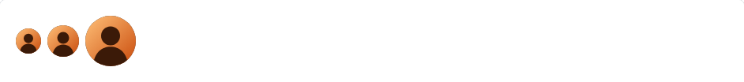 | Avatar rond : `` ou initiales `<span class="avatar" role="img" aria-label="Nom">AK</span>` (alt="" ou aria-hidden="true" s'il est décoratif). Groupe empilé avec chevauchement : `<div class="avatar-group">`. | `NoraAvatar` / `NoraAvatar` |
| [`badge`](composants/badge.md) | 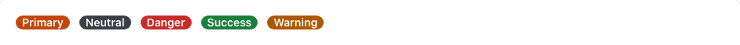 | Étiquette courte de statut. | `NoraBadge` / `NoraBadge` |
| [`btn`](composants/btn.md) | 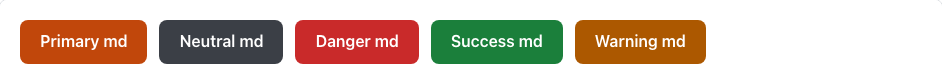 | Bouton d'action. Utiliser `<button>` pour une action, `<a href>` pour une navigation. | `NoraBtn` / `NoraBtn` |
| [`card`](composants/card.md) | 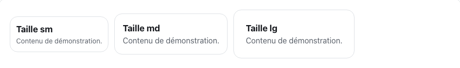 | Conteneur de contenu. Peut recevoir des effets (data-fx) et la surface fx-glass. | `NoraCard` / `NoraCard` |
| [`checkbox`](composants/checkbox.md) |  | Case à cocher : un `<label class="checkbox">` contenant `<input type="checkbox">` et son texte (zone cliquable ≥ 44 px). | `NoraCheckbox` / `NoraCheckbox` |
| [`field`](composants/field.md) |  | Groupe de champ : libellé (.field-label), contrôle, aide (.field-help) et erreur (.field-error). Relier aide et erreur au contrôle par aria-describedby. | `NoraField` / `NoraField` |
| [`input`](composants/input.md) | 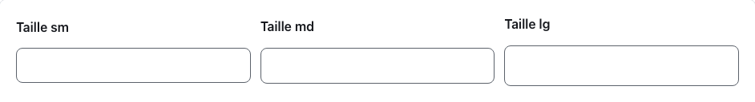 | Champ de saisie sur une ligne. Toujours associé à un `<label for>` (ou placé dans un .field). Invalide : aria-invalid="true" + aria-describedby vers le message. | `NoraInput` / `NoraInput` |
| [`link`](composants/link.md) |  | Lien texte : `<a class="link" href="…">`. Souligné, focus visible, ton de couleur. Lien externe (target="_blank" ou rel="external") signalé par une flèche décorative ; data-visited distingue les liens déjà visités. | `NoraLink` / `NoraLink` |
| [`media`](composants/media.md) | 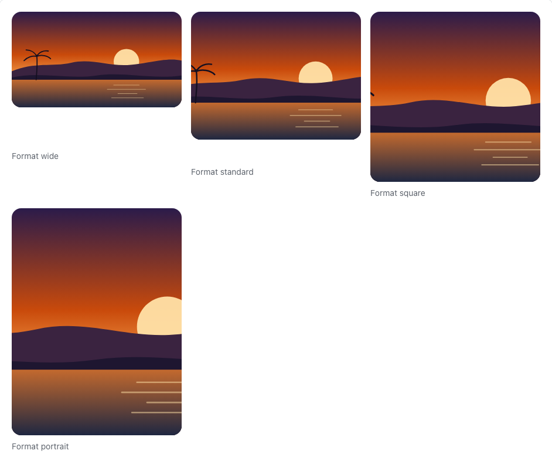 | Bloc image ou illustration : `<figure class="media" data-size="wide">` avec ``, légende .media-caption (`<figcaption>`) et texte en surimpression .media-overlay (dégradé de lisibilité). data-size fixe le format : wide 16/9, standard 4/3, square 1/1, portrait 3/4. | `NoraMedia` / `NoraMedia` |
| [`navbar`](composants/navbar.md) | 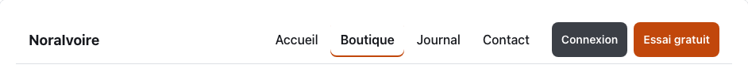 | Barre de navigation : `<nav class="navbar" aria-label="…">` avec .navbar-brand, une liste .navbar-menu de liens (page courante : aria-current="page") et .navbar-actions. Sans JavaScript : sur petit écran, le menu passe sous la marque et défile horizontalement. | `NoraNavbar` / `NoraNavbar` |
| [`radio`](composants/radio.md) | 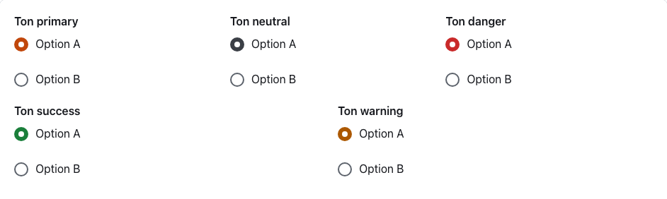 | Bouton radio : un `<label class="radio">` contenant `<input type="radio" name="…">` et son texte (zone cliquable ≥ 44 px). Grouper les options d'une même question dans un `<fieldset class="field">` avec `<legend class="field-label">`. | `NoraRadio` / `NoraRadio` |
| [`select`](composants/select.md) | 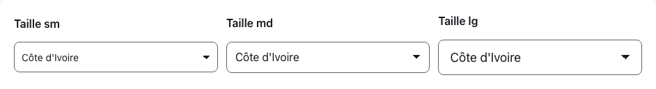 | Liste de choix native. Toujours associée à un `<label for>`. | `NoraSelect` / `NoraSelect` |
| [`switch`](composants/switch.md) | 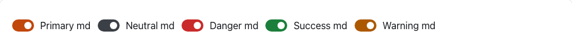 | Interrupteur marche/arrêt : un `<label class="switch">` contenant `<input type="checkbox" role="switch">` et son texte. Effet immédiat, sans bouton Valider. | `NoraSwitch` / `NoraSwitch` |
| [`textarea`](composants/textarea.md) |  | Zone de texte sur plusieurs lignes, redimensionnable verticalement. Toujours associée à un `<label for>`. | `NoraTextarea` / `NoraTextarea` |

## Effets (8)

| Effet | Aperçu | Description | Paquet |
|---|---|---|---|
| [`glass`](effets/glass.md) | 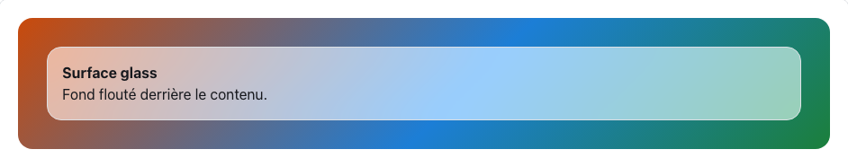 | Surface translucide floutée (glassmorphism). | cœur |
| [`parallax`](effets/parallax.md) |  | Décale verticalement l'élément selon sa position dans la fenêtre (effet de profondeur). | `@jonathankablan/noraivoire-fx-scroll` |
| [`pin`](effets/pin.md) |  | Épingle l'élément (position: sticky) pendant le défilement de son parent et expose la progression dans --fx-pin-progress. | `@jonathankablan/noraivoire-fx-scroll` |
| [`reveal`](effets/reveal.md) | 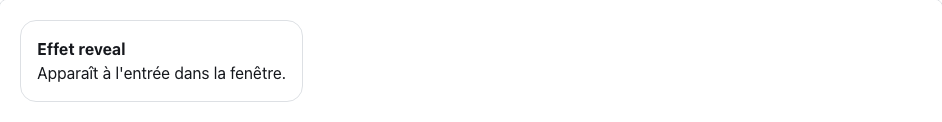 | Fait apparaître l'élément (fondu + translation) quand il entre dans la zone visible. | cœur |
| [`scramble`](effets/scramble.md) | 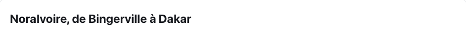 | Révèle un texte court en faisant défiler des caractères aléatoires ; le texte réel est exposé aux lecteurs d'écran. | `@jonathankablan/noraivoire-fx-text` |
| [`scrub`](effets/scrub.md) | 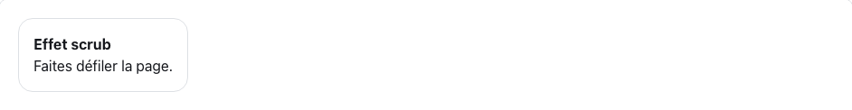 | Expose la progression de l'élément dans la fenêtre (0 → 1) dans --fx-progress, pour piloter une animation CSS au défilement. | `@jonathankablan/noraivoire-fx-scroll` |
| [`split`](effets/split.md) |  | Découpe un texte en lettres ou en mots animés en cascade à l'apparition ; le texte complet reste lu une seule fois par les lecteurs d'écran. | `@jonathankablan/noraivoire-fx-text` |
| [`tilt`](effets/tilt.md) | 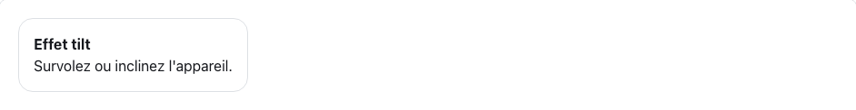 | Incline l'élément selon l'orientation de l'utilisateur : souris sur desktop, gyroscope sur mobile. | cœur |

## Régénérer

```bash
npm run build                # spec/ → packages/core/dist/
npm run docs:reference       # ce dossier (Markdown, vérifié par les tests)
npm run docs:reference:shots # aperçus (Playwright)
```
