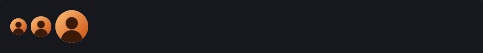
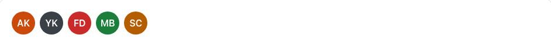
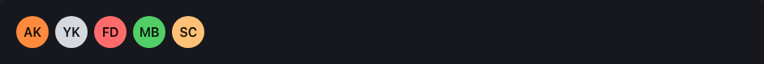

<!-- Généré par tools/docs/reference.mjs depuis packages/core/dist/manifest.json. Ne pas modifier à la main : npm run docs:reference. © 2026 Jonathan KABLAN — Propriétaire. -->

[← Référence](../README.md)

# Composant `avatar`

Avatar rond : `` ou initiales `<span class="avatar" role="img" aria-label="Nom">AK</span>` (alt="" ou aria-hidden="true" s'il est décoratif). Groupe empilé avec chevauchement : `<div class="avatar-group">`.

| Propriété | Valeur |
|---|---|
| Classe | `.avatar` |
| Forme (spec) | `avatar` |
| Éléments | ``, `<span>` |
| Tons (`data-tone`) | `primary`, `neutral`, `danger`, `success`, `warning` — défaut `neutral` |
| Tailles (`data-size`) | `sm`, `md`, `lg` — défaut `md` |
| Parties | `.avatar-group` |
| États | — |
| Flutter | `NoraAvatar` |
| React Native | `NoraAvatar` |
| Twig Component | `Nora:Avatar` |

## Usage par cible

### HTML

```html
<div class="cluster">
</div>
```

### React

```jsx
<div className="cluster">
</div>
```

### Vue

```vue
<template>
  <div class="cluster">
  </div>
</template>
```

### Twig (Symfony)

```twig
<twig:Nora:Avatar as="span" tone="primary" role="img" aria-label="Awa Koné">AK</twig:Nora:Avatar>
```

### Flutter

```dart
NoraAvatar(
  image: const AssetImage('assets/awa.jpg'),
  initials: 'AK',
  label: 'Awa Koné',
)
```

### React Native

```tsx
<NoraAvatar source={require('./awa.jpg')} initials="AK" label="Awa Koné" />
```

## Exemples

### Image

alt obligatoire : le nom de la personne (alt="" si l'avatar est purement décoratif).

| Clair | Sombre |
|---|---|
|  |  |

<details><summary>HTML</summary>

```html
<div class="cluster">
</div>
```

</details>

<details><summary>React (JSX)</summary>

```jsx
<div className="cluster">
</div>
```

</details>

### Initiales et tons

Sans image : role="img" et aria-label. data-tone : primary, neutral, danger, success, warning.

| Clair | Sombre |
|---|---|
|  |  |

<details><summary>HTML</summary>

```html
<div class="cluster">
  <span class="avatar" data-tone="primary" role="img" aria-label="Personne 1">AK</span>
  <span class="avatar" data-tone="neutral" role="img" aria-label="Personne 2">YK</span>
  <span class="avatar" data-tone="danger" role="img" aria-label="Personne 3">FD</span>
  <span class="avatar" data-tone="success" role="img" aria-label="Personne 4">MB</span>
  <span class="avatar" data-tone="warning" role="img" aria-label="Personne 5">SC</span>
</div>
```

</details>

<details><summary>React (JSX)</summary>

```jsx
<div className="cluster">
  <span className="avatar" data-tone="primary" role="img" aria-label="Personne 1">AK</span>
  <span className="avatar" data-tone="neutral" role="img" aria-label="Personne 2">YK</span>
  <span className="avatar" data-tone="danger" role="img" aria-label="Personne 3">FD</span>
  <span className="avatar" data-tone="success" role="img" aria-label="Personne 4">MB</span>
  <span className="avatar" data-tone="warning" role="img" aria-label="Personne 5">SC</span>
</div>
```

</details>

### Groupe empilé

.avatar-group : chevauchement d'un quart, anneau de la couleur de surface.

| Clair | Sombre |
|---|---|
|  |  |

<details><summary>HTML</summary>

```html
<div class="avatar-group">
  <span class="avatar" data-tone="primary" role="img" aria-label="Yao Kouassi">YK</span>
  <span class="avatar" data-tone="success" role="img" aria-label="Fatou Diallo">FD</span>
  <span class="avatar" role="img" aria-label="Et 12 autres personnes">+12</span>
</div>
```

</details>

<details><summary>React (JSX)</summary>

```jsx
<div className="avatar-group">
  <span className="avatar" data-tone="primary" role="img" aria-label="Yao Kouassi">YK</span>
  <span className="avatar" data-tone="success" role="img" aria-label="Fatou Diallo">FD</span>
  <span className="avatar" role="img" aria-label="Et 12 autres personnes">+12</span>
</div>
```

</details>

## Personnalisation

Tokens du composant, à redéfinir **sur l'élément lui-même** (une valeur posée sur un parent n'est pas héritée, voir [TECHNICAL §4.2](../../TECHNICAL.md#42-trois-niveaux-de-personnalisation)) : `--avatar-bg`, `--avatar-fg`, `--avatar-radius`, `--avatar-ring`, `--avatar-pad-y`, `--avatar-pad-x`, `--avatar-font`, `--avatar-box`.

| Clair | Sombre |
|---|---|
|  |  |

```css
.marque-avatar {
  --avatar-radius: 0px;
  --avatar-bg: #0B7285;
  --avatar-fg: #FFFFFF;
}
```

```html
<span class="avatar marque-avatar" role="img" aria-label="Personnalisé">PE</span>
```

## Accessibilité

| Critère | Valeur |
|---|---|
| Rôle | `img` |
| Cible minimale | — |
| Libellé requis | oui |
| Focus visible | sans objet |
| Mouvement réduit | transitions coupées par `prefers-reduced-motion` |

**Contrôlé par `nora check`** : [`invalid-variant`](../nora-check.md#invalid-variant), [`a11y-img-alt`](../nora-check.md#a11y-img-alt), [`a11y-img-role`](../nora-check.md#a11y-img-role).
