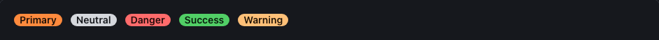
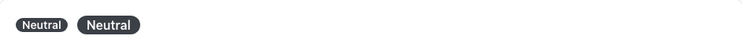
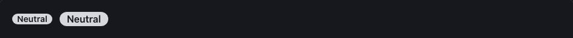

<!-- Généré par tools/docs/reference.mjs depuis packages/core/dist/manifest.json. Ne pas modifier à la main : npm run docs:reference. © 2026 Jonathan KABLAN — Propriétaire. -->

[← Référence](../README.md)

# Composant `badge`

Étiquette courte de statut.

| Propriété | Valeur |
|---|---|
| Classe | `.badge` |
| Forme (spec) | `label` |
| Éléments | `<span>` |
| Tons (`data-tone`) | `primary`, `neutral`, `danger`, `success`, `warning` — défaut `neutral` |
| Tailles (`data-size`) | `sm`, `md` — défaut `sm` |
| Parties | — |
| États | — |
| Flutter | `NoraBadge` |
| React Native | `NoraBadge` |
| Twig Component | `Nora:Badge` |

## Usage par cible

### HTML

```html
<span class="badge" data-tone="primary" data-size="sm">Primary</span>
```

### React

```jsx
<span className="badge" data-tone="primary" data-size="sm">Primary</span>
```

### Vue

```vue
<template>
  <span class="badge" data-tone="primary" data-size="sm">Primary</span>
</template>
```

### Twig (Symfony)

```twig
<twig:Nora:Badge tone="neutral">Nouveau</twig:Nora:Badge>
```

### Flutter

```dart
NoraBadge(tone: NoraTone.neutral, child: const Text('Nouveau'))
```

### React Native

```tsx
<NoraBadge tone="neutral">Nouveau</NoraBadge>
```

## Exemples

### Tons

Attribut data-tone : primary, neutral, danger, success, warning (défaut neutral).

| Clair | Sombre |
|---|---|
|  |  |

<details><summary>HTML</summary>

```html
<span class="badge" data-tone="primary" data-size="sm">Primary</span>
<span class="badge" data-tone="neutral" data-size="sm">Neutral</span>
<span class="badge" data-tone="danger" data-size="sm">Danger</span>
<span class="badge" data-tone="success" data-size="sm">Success</span>
<span class="badge" data-tone="warning" data-size="sm">Warning</span>
```

</details>

<details><summary>React (JSX)</summary>

```jsx
<span className="badge" data-tone="primary" data-size="sm">Primary</span>
<span className="badge" data-tone="neutral" data-size="sm">Neutral</span>
<span className="badge" data-tone="danger" data-size="sm">Danger</span>
<span className="badge" data-tone="success" data-size="sm">Success</span>
<span className="badge" data-tone="warning" data-size="sm">Warning</span>
```

</details>

### Tailles

Attribut data-size : sm, md (défaut sm).

| Clair | Sombre |
|---|---|
|  |  |

<details><summary>HTML</summary>

```html
<span class="badge" data-tone="neutral" data-size="sm">Neutral</span>
<span class="badge" data-tone="neutral" data-size="md">Neutral</span>
```

</details>

<details><summary>React (JSX)</summary>

```jsx
<span className="badge" data-tone="neutral" data-size="sm">Neutral</span>
<span className="badge" data-tone="neutral" data-size="md">Neutral</span>
```

</details>

## Personnalisation

Tokens du composant, à redéfinir **sur l'élément lui-même** (une valeur posée sur un parent n'est pas héritée, voir [TECHNICAL §4.2](../../TECHNICAL.md#42-trois-niveaux-de-personnalisation)) : `--badge-bg`, `--badge-fg`, `--badge-radius`, `--badge-pad-y`, `--badge-pad-x`, `--badge-font`.

| Clair | Sombre |
|---|---|
|  |  |

```css
.marque-badge {
  --badge-radius: 0px;
  --badge-bg: #0B7285;
  --badge-fg: #FFFFFF;
}
```

```html
<span class="badge marque-badge">Personnalisé</span>
```

## Accessibilité

| Critère | Valeur |
|---|---|
| Rôle | `status` |
| Cible minimale | — |
| Libellé requis | oui |
| Focus visible | sans objet |
| Mouvement réduit | transitions coupées par `prefers-reduced-motion` |

**Contrôlé par `nora check`** : [`invalid-variant`](../nora-check.md#invalid-variant), [`unexpected-element`](../nora-check.md#unexpected-element).
