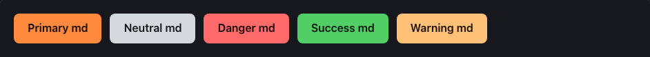
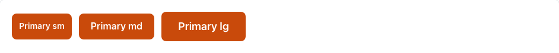
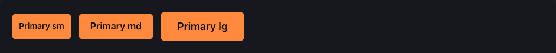
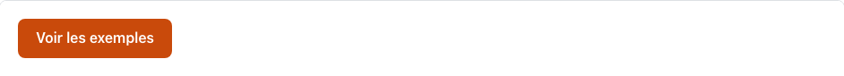
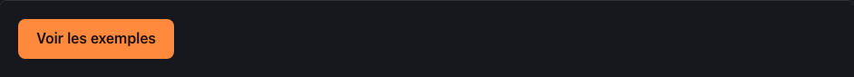
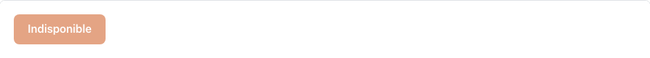
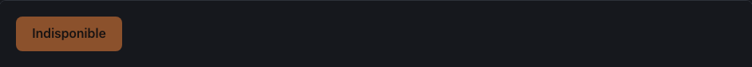
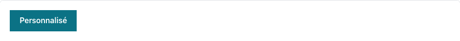
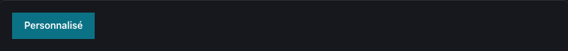

<!-- Généré par tools/docs/reference.mjs depuis packages/core/dist/manifest.json. Ne pas modifier à la main : npm run docs:reference. © 2026 Jonathan KABLAN — Propriétaire. -->

[← Référence](../README.md)

# Composant `btn`

Bouton d'action. Utiliser `<button>` pour une action, `<a href>` pour une navigation.

| Propriété | Valeur |
|---|---|
| Classe | `.btn` |
| Forme (spec) | `interactive` |
| Éléments | `<button>`, `<a>` |
| Tons (`data-tone`) | `primary`, `neutral`, `danger`, `success`, `warning` — défaut `primary` |
| Tailles (`data-size`) | `sm`, `md`, `lg` — défaut `md` |
| Parties | — |
| États | `pressed`, `disabled` |
| Flutter | `NoraBtn` |
| React Native | `NoraBtn` |
| Twig Component | `Nora:Btn` |

## Usage par cible

### HTML

```html
<button class="btn" data-tone="primary" data-size="md" type="button">Primary md</button>
```

### React

```jsx
<button className="btn" data-tone="primary" data-size="md" type="button">Primary md</button>
```

### Vue

```vue
<template>
  <button class="btn" data-tone="primary" data-size="md" type="button">Primary md</button>
</template>
```

### Twig (Symfony)

```twig
<twig:Nora:Btn tone="primary" size="md">Valider</twig:Nora:Btn>
```

### JSP

```jsp
<%@ taglib prefix="nora" tagdir="/WEB-INF/tags/nora" %>
<nora:btn tone="primary" size="md" href="/commandes">Ouvrir</nora:btn>
```

### Flutter

```dart
NoraBtn(
  tone: NoraTone.primary,
  size: NoraSize.md,
  onPressed: () {},
  child: const Text('Valider'),
)
```

### React Native

```tsx
<NoraBtn tone="primary" size="md" onPress={() => {}}>
  Valider
</NoraBtn>
```

## Exemples

### Tons

Attribut data-tone : primary, neutral, danger, success, warning (défaut primary).

| Clair | Sombre |
|---|---|
|  |  |

<details><summary>HTML</summary>

```html
<button class="btn" data-tone="primary" data-size="md" type="button">Primary md</button>
<button class="btn" data-tone="neutral" data-size="md" type="button">Neutral md</button>
<button class="btn" data-tone="danger" data-size="md" type="button">Danger md</button>
<button class="btn" data-tone="success" data-size="md" type="button">Success md</button>
<button class="btn" data-tone="warning" data-size="md" type="button">Warning md</button>
```

</details>

<details><summary>React (JSX)</summary>

```jsx
<button className="btn" data-tone="primary" data-size="md" type="button">Primary md</button>
<button className="btn" data-tone="neutral" data-size="md" type="button">Neutral md</button>
<button className="btn" data-tone="danger" data-size="md" type="button">Danger md</button>
<button className="btn" data-tone="success" data-size="md" type="button">Success md</button>
<button className="btn" data-tone="warning" data-size="md" type="button">Warning md</button>
```

</details>

### Tailles

Attribut data-size : sm, md, lg (défaut md).

| Clair | Sombre |
|---|---|
|  |  |

<details><summary>HTML</summary>

```html
<button class="btn" data-tone="primary" data-size="sm" type="button">Primary sm</button>
<button class="btn" data-tone="primary" data-size="md" type="button">Primary md</button>
<button class="btn" data-tone="primary" data-size="lg" type="button">Primary lg</button>
```

</details>

<details><summary>React (JSX)</summary>

```jsx
<button className="btn" data-tone="primary" data-size="sm" type="button">Primary sm</button>
<button className="btn" data-tone="primary" data-size="md" type="button">Primary md</button>
<button className="btn" data-tone="primary" data-size="lg" type="button">Primary lg</button>
```

</details>

### Lien

Une navigation utilise `<a href>` avec la même classe (href obligatoire).

| Clair | Sombre |
|---|---|
|  |  |

<details><summary>HTML</summary>

```html
<a class="btn" data-tone="primary" href="#exemples">Voir les exemples</a>
```

</details>

<details><summary>React (JSX)</summary>

```jsx
<a className="btn" data-tone="primary" href="#exemples">Voir les exemples</a>
```

</details>

### Désactivé

Attribut natif disabled : non focalisable, opacité réduite.

| Clair | Sombre |
|---|---|
|  |  |

<details><summary>HTML</summary>

```html
<button class="btn" data-tone="primary" type="button" disabled>Indisponible</button>
```

</details>

<details><summary>React (JSX)</summary>

```jsx
<button className="btn" data-tone="primary" type="button" disabled>Indisponible</button>
```

</details>

## Personnalisation

Tokens du composant, à redéfinir **sur l'élément lui-même** (une valeur posée sur un parent n'est pas héritée, voir [TECHNICAL §4.2](../../TECHNICAL.md#42-trois-niveaux-de-personnalisation)) : `--btn-bg`, `--btn-fg`, `--btn-radius`, `--btn-pad-y`, `--btn-pad-x`, `--btn-font`.

| Clair | Sombre |
|---|---|
|  |  |

```css
.marque-btn {
  --btn-radius: 0px;
  --btn-bg: #0B7285;
  --btn-fg: #FFFFFF;
}
```

```html
<button class="btn marque-btn" type="button">Personnalisé</button>
```

## Accessibilité

| Critère | Valeur |
|---|---|
| Rôle | `button` |
| Cible minimale | 44 px |
| Libellé requis | oui |
| Focus visible | oui (anneau `--nora-color-focus`, `:focus-visible`) |
| Mouvement réduit | transitions coupées par `prefers-reduced-motion` |

**Contrôlé par `nora check`** : [`invalid-variant`](../nora-check.md#invalid-variant), [`unexpected-element`](../nora-check.md#unexpected-element), [`a11y-anchor-href`](../nora-check.md#a11y-anchor-href), [`a11y-label`](../nora-check.md#a11y-label).
