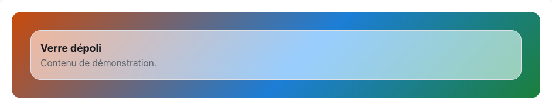
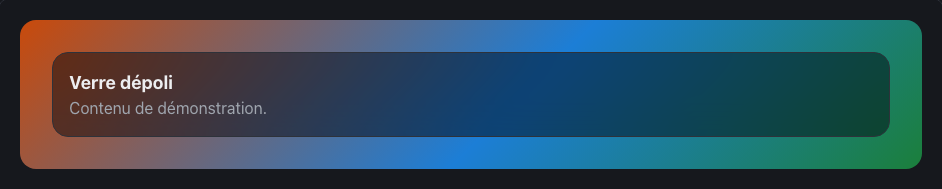

<!-- Généré par tools/docs/reference.mjs depuis packages/core/dist/manifest.json. Ne pas modifier à la main : npm run docs:reference. © 2026 Jonathan KABLAN — Propriétaire. -->

[← Référence](../README.md)

# Composant `card`

Conteneur de contenu. Peut recevoir des effets (data-fx) et la surface fx-glass.

| Propriété | Valeur |
|---|---|
| Classe | `.card` |
| Forme (spec) | `container` |
| Éléments | `<div>`, `<article>`, `<section>`, `<li>` |
| Tons (`data-tone`) | `neutral` — défaut `neutral` |
| Tailles (`data-size`) | `sm`, `md`, `lg` — défaut `md` |
| Parties | — |
| États | — |
| Flutter | `NoraCard` |
| React Native | `NoraCard` |
| Twig Component | `Nora:Card` |

## Usage par cible

### HTML

```html
<div class="card" data-size="sm">
  <h3 class="text-lg font-bold">Taille sm</h3>
  <p class="text-muted">Contenu de démonstration.</p>
</div>
```

### React

```jsx
<div className="card" data-size="sm">
  <h3 className="text-lg font-bold">Taille sm</h3>
  <p className="text-muted">Contenu de démonstration.</p>
</div>
```

### Vue

```vue
<template>
  <div class="card" data-size="sm">
    <h3 class="text-lg font-bold">Taille sm</h3>
    <p class="text-muted">Contenu de démonstration.</p>
  </div>
</template>
```

### Twig (Symfony)

```twig
<twig:Nora:Card size="md">Contenu</twig:Nora:Card>
```

### Flutter

```dart
NoraCard(
  size: NoraSize.md,
  child: const Text('Contenu'),
)
```

### React Native

```tsx
<NoraCard size="md">
  <Text>Contenu</Text>
</NoraCard>
```

## Exemples

### Tailles

data-size règle l'espacement intérieur : sm, md, lg.

| Clair | Sombre |
|---|---|
|  |  |

<details><summary>HTML</summary>

```html
<div class="card" data-size="sm">
  <h3 class="text-lg font-bold">Taille sm</h3>
  <p class="text-muted">Contenu de démonstration.</p>
</div>
<div class="card" data-size="md">
  <h3 class="text-lg font-bold">Taille md</h3>
  <p class="text-muted">Contenu de démonstration.</p>
</div>
<div class="card" data-size="lg">
  <h3 class="text-lg font-bold">Taille lg</h3>
  <p class="text-muted">Contenu de démonstration.</p>
</div>
```

</details>

<details><summary>React (JSX)</summary>

```jsx
<div className="card" data-size="sm">
  <h3 className="text-lg font-bold">Taille sm</h3>
  <p className="text-muted">Contenu de démonstration.</p>
</div>
<div className="card" data-size="md">
  <h3 className="text-lg font-bold">Taille md</h3>
  <p className="text-muted">Contenu de démonstration.</p>
</div>
<div className="card" data-size="lg">
  <h3 className="text-lg font-bold">Taille lg</h3>
  <p className="text-muted">Contenu de démonstration.</p>
</div>
```

</details>

### Surface verre

Surfaces : fx-glass (à poser sur un fond contrasté).

| Clair | Sombre |
|---|---|
|  |  |

<details><summary>HTML</summary>

```html
<div class="cat-backdrop">
  <div class="card fx-glass">
    <h3 class="text-lg font-bold">Verre dépoli</h3>
    <p class="text-muted">Contenu de démonstration.</p>
  </div>
</div>
```

</details>

<details><summary>React (JSX)</summary>

```jsx
<div className="cat-backdrop">
  <div className="card fx-glass">
    <h3 className="text-lg font-bold">Verre dépoli</h3>
    <p className="text-muted">Contenu de démonstration.</p>
  </div>
</div>
```

</details>

## Personnalisation

Tokens du composant, à redéfinir **sur l'élément lui-même** (une valeur posée sur un parent n'est pas héritée, voir [TECHNICAL §4.2](../../TECHNICAL.md#42-trois-niveaux-de-personnalisation)) : `--card-bg`, `--card-fg`, `--card-radius`, `--card-border`, `--card-pad-y`, `--card-pad-x`, `--card-font`.

| Clair | Sombre |
|---|---|
|  |  |

```css
.marque-card {
  --card-radius: 0px;
  --card-bg: #0B7285;
  --card-fg: #FFFFFF;
}
```

```html
<div class="card marque-card">Personnalisé
</div>
```

## Accessibilité

| Critère | Valeur |
|---|---|
| Rôle | `none` |
| Cible minimale | — |
| Libellé requis | non |
| Focus visible | sans objet |
| Mouvement réduit | transitions coupées par `prefers-reduced-motion` |

**Contrôlé par `nora check`** : [`invalid-variant`](../nora-check.md#invalid-variant), [`unexpected-element`](../nora-check.md#unexpected-element).
