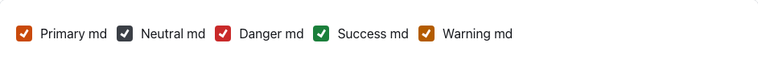
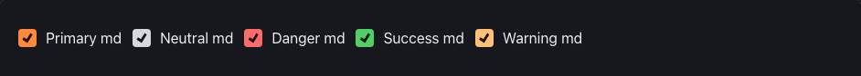
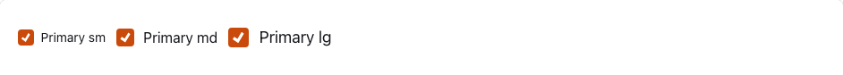
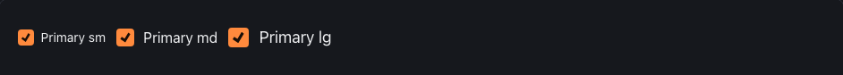
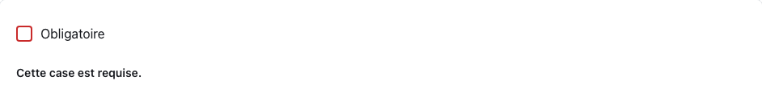
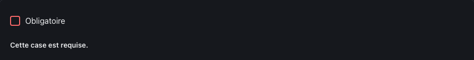
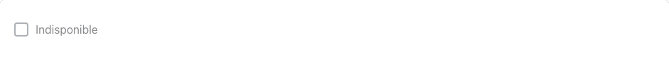
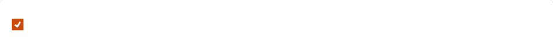

<!-- Généré par tools/docs/reference.mjs depuis packages/core/dist/manifest.json. Ne pas modifier à la main : npm run docs:reference. © 2026 Jonathan KABLAN — Propriétaire. -->

[← Référence](../README.md)

# Composant `checkbox`

Case à cocher : un `<label class="checkbox">` contenant `<input type="checkbox">` et son texte (zone cliquable ≥ 44 px).

| Propriété | Valeur |
|---|---|
| Classe | `.checkbox` |
| Forme (spec) | `toggle` |
| Éléments | `<label>` |
| Tons (`data-tone`) | `primary`, `neutral`, `danger`, `success`, `warning` — défaut `primary` |
| Tailles (`data-size`) | `sm`, `md`, `lg` — défaut `md` |
| Parties | — |
| États | `focus`, `invalid`, `disabled` |
| Flutter | `NoraCheckbox` |
| React Native | `NoraCheckbox` |
| Twig Component | `Nora:Checkbox` |

## Usage par cible

### HTML

```html
<label class="checkbox" data-tone="primary" data-size="md"><input type="checkbox" name="checkbox-primary-md" checked> Primary md</label>
```

### React

```jsx
<label className="checkbox" data-tone="primary" data-size="md"><input type="checkbox" name="checkbox-primary-md" defaultChecked /> Primary md</label>
```

### Vue

```vue
<template>
  <label class="checkbox" data-tone="primary" data-size="md"><input type="checkbox" name="checkbox-primary-md" checked> Primary md</label>
</template>
```

### Twig (Symfony)

```twig
<twig:Nora:Checkbox><input type="checkbox" name="choix"> Libellé</twig:Nora:Checkbox>
```

### Flutter

```dart
NoraCheckbox(
  value: actif,
  onChanged: (v) => setState(() => actif = v),
  child: const Text('Libellé'),
)
```

### React Native

```tsx
<NoraCheckbox checked={actif} onChange={setActif}>
  Libellé
</NoraCheckbox>
```

## Exemples

### Tons

Attribut data-tone : primary, neutral, danger, success, warning (défaut primary).

| Clair | Sombre |
|---|---|
|  |  |

<details><summary>HTML</summary>

```html
<label class="checkbox" data-tone="primary" data-size="md"><input type="checkbox" name="checkbox-primary-md" checked> Primary md</label>
<label class="checkbox" data-tone="neutral" data-size="md"><input type="checkbox" name="checkbox-neutral-md" checked> Neutral md</label>
<label class="checkbox" data-tone="danger" data-size="md"><input type="checkbox" name="checkbox-danger-md" checked> Danger md</label>
<label class="checkbox" data-tone="success" data-size="md"><input type="checkbox" name="checkbox-success-md" checked> Success md</label>
<label class="checkbox" data-tone="warning" data-size="md"><input type="checkbox" name="checkbox-warning-md" checked> Warning md</label>
```

</details>

<details><summary>React (JSX)</summary>

```jsx
<label className="checkbox" data-tone="primary" data-size="md"><input type="checkbox" name="checkbox-primary-md" defaultChecked /> Primary md</label>
<label className="checkbox" data-tone="neutral" data-size="md"><input type="checkbox" name="checkbox-neutral-md" defaultChecked /> Neutral md</label>
<label className="checkbox" data-tone="danger" data-size="md"><input type="checkbox" name="checkbox-danger-md" defaultChecked /> Danger md</label>
<label className="checkbox" data-tone="success" data-size="md"><input type="checkbox" name="checkbox-success-md" defaultChecked /> Success md</label>
<label className="checkbox" data-tone="warning" data-size="md"><input type="checkbox" name="checkbox-warning-md" defaultChecked /> Warning md</label>
```

</details>

### Tailles

Attribut data-size : sm, md, lg (défaut md).

| Clair | Sombre |
|---|---|
|  |  |

<details><summary>HTML</summary>

```html
<label class="checkbox" data-tone="primary" data-size="sm"><input type="checkbox" name="checkbox-primary-sm" checked> Primary sm</label>
<label class="checkbox" data-tone="primary" data-size="md"><input type="checkbox" name="checkbox-primary-md" checked> Primary md</label>
<label class="checkbox" data-tone="primary" data-size="lg"><input type="checkbox" name="checkbox-primary-lg" checked> Primary lg</label>
```

</details>

<details><summary>React (JSX)</summary>

```jsx
<label className="checkbox" data-tone="primary" data-size="sm"><input type="checkbox" name="checkbox-primary-sm" defaultChecked /> Primary sm</label>
<label className="checkbox" data-tone="primary" data-size="md"><input type="checkbox" name="checkbox-primary-md" defaultChecked /> Primary md</label>
<label className="checkbox" data-tone="primary" data-size="lg"><input type="checkbox" name="checkbox-primary-lg" defaultChecked /> Primary lg</label>
```

</details>

### Invalide

aria-invalid="true" sur l'input, relié au message.

| Clair | Sombre |
|---|---|
|  |  |

<details><summary>HTML</summary>

```html
<div class="stack">
  <label class="checkbox" data-tone="primary"><input type="checkbox" name="checkbox-err-1" aria-invalid="true" aria-describedby="checkbox-err-1-msg"> Obligatoire</label>
  <p class="field-error" id="checkbox-err-1-msg">Cette case est requise.</p>
</div>
```

</details>

<details><summary>React (JSX)</summary>

```jsx
<div className="stack">
  <label className="checkbox" data-tone="primary"><input type="checkbox" name="checkbox-err-1" aria-invalid="true" aria-describedby="checkbox-err-1-msg" /> Obligatoire</label>
  <p className="field-error" id="checkbox-err-1-msg">Cette case est requise.</p>
</div>
```

</details>

### Désactivé

Attribut natif disabled sur l'input.

| Clair | Sombre |
|---|---|
|  |  |

<details><summary>HTML</summary>

```html
<label class="checkbox" data-tone="primary" data-size="md"><input type="checkbox" name="checkbox-off" disabled> Indisponible</label>
```

</details>

<details><summary>React (JSX)</summary>

```jsx
<label className="checkbox" data-tone="primary" data-size="md"><input type="checkbox" name="checkbox-off" disabled /> Indisponible</label>
```

</details>

## Personnalisation

Tokens du composant, à redéfinir **sur l'élément lui-même** (une valeur posée sur un parent n'est pas héritée, voir [TECHNICAL §4.2](../../TECHNICAL.md#42-trois-niveaux-de-personnalisation)) : `--checkbox-bg`, `--checkbox-fg`, `--checkbox-radius`, `--checkbox-border`, `--checkbox-accent`, `--checkbox-on-accent`, `--checkbox-focus`, `--checkbox-invalid`, `--checkbox-pad-y`, `--checkbox-pad-x`, `--checkbox-font`.

| Clair | Sombre |
|---|---|
|  |  |

```css
.marque-checkbox {
  --checkbox-radius: 0px;
  --checkbox-bg: #0B7285;
  --checkbox-fg: #FFFFFF;
}
```

```html
<label class="checkbox marque-checkbox"><input type="checkbox" name="marque-checkbox" checked> Personnalisé</label>
```

## Accessibilité

| Critère | Valeur |
|---|---|
| Rôle | `checkbox` |
| Cible minimale | 44 px |
| Libellé requis | oui |
| Focus visible | oui (anneau `--nora-color-focus`, `:focus-visible`) |
| Mouvement réduit | transitions coupées par `prefers-reduced-motion` |

**Contrôlé par `nora check`** : [`invalid-variant`](../nora-check.md#invalid-variant), [`a11y-toggle-input`](../nora-check.md#a11y-toggle-input), [`a11y-form-label`](../nora-check.md#a11y-form-label).
