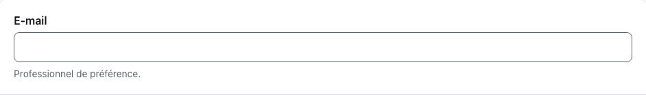
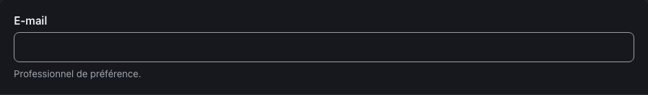
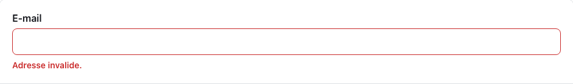
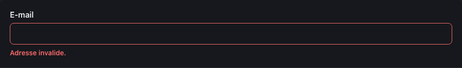
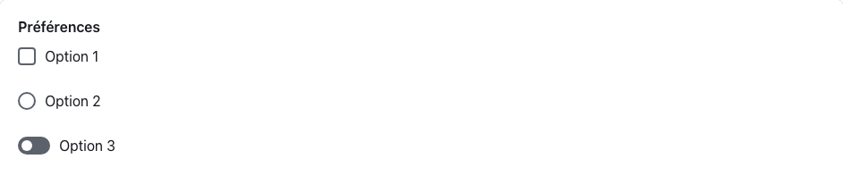
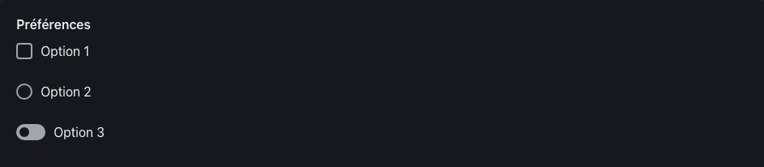
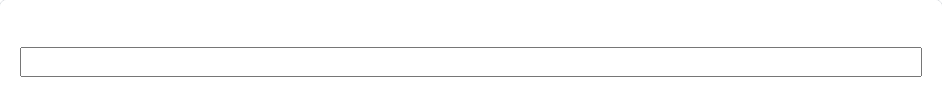
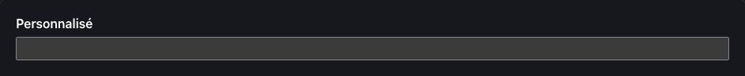

<!-- Généré par tools/docs/reference.mjs depuis packages/core/dist/manifest.json. Ne pas modifier à la main : npm run docs:reference. © 2026 Jonathan KABLAN — Propriétaire. -->

[← Référence](../README.md)

# Composant `field`

Groupe de champ : libellé (.field-label), contrôle, aide (.field-help) et erreur (.field-error). Relier aide et erreur au contrôle par aria-describedby.

| Propriété | Valeur |
|---|---|
| Classe | `.field` |
| Forme (spec) | `group` |
| Éléments | `<div>`, `<fieldset>` |
| Tons (`data-tone`) | `neutral` — défaut `neutral` |
| Tailles (`data-size`) | `sm`, `md`, `lg` — défaut `md` |
| Parties | `.field-label`, `.field-help`, `.field-error` |
| États | `invalid`, `disabled` |
| Flutter | `NoraField` |
| React Native | `NoraField` |
| Twig Component | `Nora:Field` |

## Usage par cible

### HTML

```html
<div class="field">
  <label class="field-label" for="field-aide-1">E-mail</label>
  <input class="input" id="field-aide-1" name="field-aide-1" type="email" aria-describedby="field-aide-1-aide">
  <p class="field-help" id="field-aide-1-aide">Professionnel de préférence.</p>
</div>
```

### React

```jsx
<div className="field">
  <label className="field-label" htmlFor="field-aide-1">E-mail</label>
  <input className="input" id="field-aide-1" name="field-aide-1" type="email" aria-describedby="field-aide-1-aide" />
  <p className="field-help" id="field-aide-1-aide">Professionnel de préférence.</p>
</div>
```

### Vue

```vue
<template>
  <div class="field">
    <label class="field-label" for="field-aide-1">E-mail</label>
    <input class="input" id="field-aide-1" name="field-aide-1" type="email" aria-describedby="field-aide-1-aide">
    <p class="field-help" id="field-aide-1-aide">Professionnel de préférence.</p>
  </div>
</template>
```

### Twig (Symfony)

```twig
<twig:Nora:Field id="email" label="E-mail" help="Professionnel de préférence." error="{{ erreur }}">
  <twig:Nora:Input type="email" {{ ...control }} />
</twig:Nora:Field>
```

### Flutter

```dart
NoraField(
  label: 'E-mail',
  help: 'Professionnel de préférence.',
  error: erreur,
  child: const NoraInput(),
)
```

### React Native

```tsx
<NoraField label="E-mail" help="Professionnel de préférence." error={erreur}>
  <NoraInput />
</NoraField>
```

## Exemples

### Libellé, contrôle et aide

L'aide est reliée au contrôle par aria-describedby.

| Clair | Sombre |
|---|---|
|  |  |

<details><summary>HTML</summary>

```html
<div class="field">
  <label class="field-label" for="field-aide-1">E-mail</label>
  <input class="input" id="field-aide-1" name="field-aide-1" type="email" aria-describedby="field-aide-1-aide">
  <p class="field-help" id="field-aide-1-aide">Professionnel de préférence.</p>
</div>
```

</details>

<details><summary>React (JSX)</summary>

```jsx
<div className="field">
  <label className="field-label" htmlFor="field-aide-1">E-mail</label>
  <input className="input" id="field-aide-1" name="field-aide-1" type="email" aria-describedby="field-aide-1-aide" />
  <p className="field-help" id="field-aide-1-aide">Professionnel de préférence.</p>
</div>
```

</details>

### Erreur

Message d'erreur relié, contrôle en aria-invalid="true".

| Clair | Sombre |
|---|---|
|  |  |

<details><summary>HTML</summary>

```html
<div class="field">
  <label class="field-label" for="field-err-2">E-mail</label>
  <input class="input" id="field-err-2" name="field-err-2" type="email" aria-invalid="true" aria-describedby="field-err-2-erreur">
  <p class="field-error" id="field-err-2-erreur">Adresse invalide.</p>
</div>
```

</details>

<details><summary>React (JSX)</summary>

```jsx
<div className="field">
  <label className="field-label" htmlFor="field-err-2">E-mail</label>
  <input className="input" id="field-err-2" name="field-err-2" type="email" aria-invalid="true" aria-describedby="field-err-2-erreur" />
  <p className="field-error" id="field-err-2-erreur">Adresse invalide.</p>
</div>
```

</details>

### Groupe (fieldset)

as fieldset : la question est portée par `<legend>`.

| Clair | Sombre |
|---|---|
|  |  |

<details><summary>HTML</summary>

```html
<fieldset class="field">
  <legend class="field-label">Préférences</legend>
  <label class="checkbox"><input type="checkbox" name="field-pref"> Option 1</label>
  <label class="radio"><input type="radio" name="field-pref"> Option 2</label>
  <label class="switch"><input type="checkbox" role="switch" name="field-pref"> Option 3</label>
</fieldset>
```

</details>

<details><summary>React (JSX)</summary>

```jsx
<fieldset className="field">
  <legend className="field-label">Préférences</legend>
  <label className="checkbox"><input type="checkbox" name="field-pref" /> Option 1</label>
  <label className="radio"><input type="radio" name="field-pref" /> Option 2</label>
  <label className="switch"><input type="checkbox" role="switch" name="field-pref" /> Option 3</label>
</fieldset>
```

</details>

## Personnalisation

Tokens du composant, à redéfinir **sur l'élément lui-même** (une valeur posée sur un parent n'est pas héritée, voir [TECHNICAL §4.2](../../TECHNICAL.md#42-trois-niveaux-de-personnalisation)) : `--field-fg`, `--field-muted`, `--field-invalid`, `--field-pad-y`, `--field-pad-x`, `--field-font`.

| Clair | Sombre |
|---|---|
|  |  |

```css
.marque-field {
  --field-fg: #FFFFFF;
}
```

```html
<div class="field marque-field">
  <label class="field-label" for="marque-field-c">Personnalisé</label>
  <input id="marque-field-c" name="marque-field" type="text">
</div>
```

## Accessibilité

| Critère | Valeur |
|---|---|
| Rôle | `group` |
| Cible minimale | — |
| Libellé requis | oui |
| Focus visible | oui (anneau `--nora-color-focus`, `:focus-visible`) |
| Mouvement réduit | transitions coupées par `prefers-reduced-motion` |

**Contrôlé par `nora check`** : [`field-label-missing`](../nora-check.md#field-label-missing), [`a11y-invalid-message`](../nora-check.md#a11y-invalid-message).
