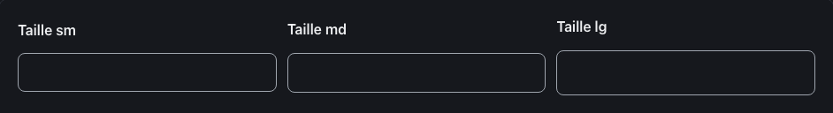
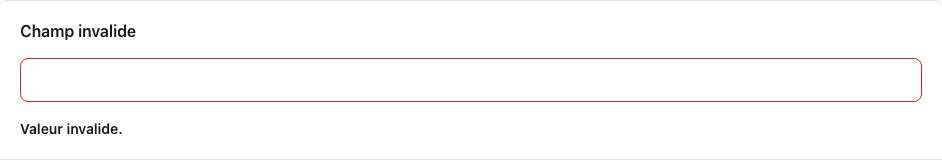
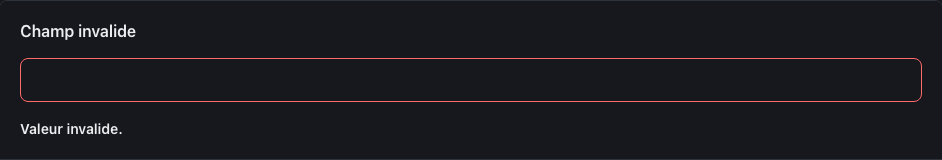
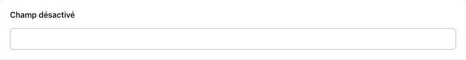
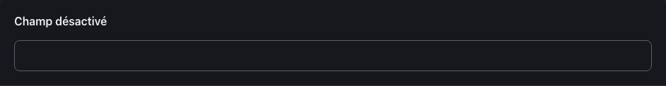
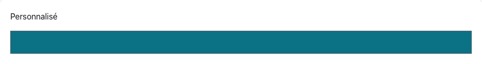
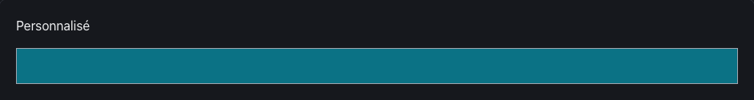

<!-- Généré par tools/docs/reference.mjs depuis packages/core/dist/manifest.json. Ne pas modifier à la main : npm run docs:reference. © 2026 Jonathan KABLAN — Propriétaire. -->

[← Référence](../README.md)

# Composant `input`

Champ de saisie sur une ligne. Toujours associé à un `<label for>` (ou placé dans un .field). Invalide : aria-invalid="true" + aria-describedby vers le message.

| Propriété | Valeur |
|---|---|
| Classe | `.input` |
| Forme (spec) | `control` |
| Éléments | `<input>` |
| Tons (`data-tone`) | `neutral` — défaut `neutral` |
| Tailles (`data-size`) | `sm`, `md`, `lg` — défaut `md` |
| Parties | — |
| États | `focus`, `invalid`, `disabled` |
| Flutter | `NoraInput` |
| React Native | `NoraInput` |
| Twig Component | `Nora:Input` |

## Usage par cible

### HTML

```html
<div class="stack">
  <label class="field-label" for="input-sm-1">Taille sm</label>
  <input class="input" id="input-sm-1" name="input-sm-1" type="text" data-size="sm">
</div>
```

### React

```jsx
<div className="stack">
  <label className="field-label" htmlFor="input-sm-1">Taille sm</label>
  <input className="input" id="input-sm-1" name="input-sm-1" type="text" data-size="sm" />
</div>
```

### Vue

```vue
<template>
  <div class="stack">
    <label class="field-label" for="input-sm-1">Taille sm</label>
    <input class="input" id="input-sm-1" name="input-sm-1" type="text" data-size="sm">
  </div>
</template>
```

### Twig (Symfony)

```twig
<twig:Nora:Field id="champ" label="Libellé">
  <twig:Nora:Input {{ ...control }} />
</twig:Nora:Field>
```

### Flutter

```dart
NoraInput(
  hint: 'Votre réponse',
  onChanged: (v) {},
)
```

### React Native

```tsx
<NoraInput label="Votre réponse" onChangeText={setValeur} />
```

## Exemples

### Tailles

Toujours associé à un libellé (`<label for>`). data-size : sm, md, lg.

| Clair | Sombre |
|---|---|
|  |  |

<details><summary>HTML</summary>

```html
<div class="stack">
  <label class="field-label" for="input-sm-1">Taille sm</label>
  <input class="input" id="input-sm-1" name="input-sm-1" type="text" data-size="sm">
</div>
<div class="stack">
  <label class="field-label" for="input-md-2">Taille md</label>
  <input class="input" id="input-md-2" name="input-md-2" type="text" data-size="md">
</div>
<div class="stack">
  <label class="field-label" for="input-lg-3">Taille lg</label>
  <input class="input" id="input-lg-3" name="input-lg-3" type="text" data-size="lg">
</div>
```

</details>

<details><summary>React (JSX)</summary>

```jsx
<div className="stack">
  <label className="field-label" htmlFor="input-sm-1">Taille sm</label>
  <input className="input" id="input-sm-1" name="input-sm-1" type="text" data-size="sm" />
</div>
<div className="stack">
  <label className="field-label" htmlFor="input-md-2">Taille md</label>
  <input className="input" id="input-md-2" name="input-md-2" type="text" data-size="md" />
</div>
<div className="stack">
  <label className="field-label" htmlFor="input-lg-3">Taille lg</label>
  <input className="input" id="input-lg-3" name="input-lg-3" type="text" data-size="lg" />
</div>
```

</details>

### Invalide

aria-invalid="true" relié au message par aria-describedby.

| Clair | Sombre |
|---|---|
|  |  |

<details><summary>HTML</summary>

```html
<div class="stack">
  <label class="field-label" for="input-invalide-4">Champ invalide</label>
  <input class="input" id="input-invalide-4" name="input-invalide-4" type="text" aria-invalid="true" aria-describedby="input-invalide-4-erreur">
  <p class="field-error" id="input-invalide-4-erreur">Valeur invalide.</p>
</div>
```

</details>

<details><summary>React (JSX)</summary>

```jsx
<div className="stack">
  <label className="field-label" htmlFor="input-invalide-4">Champ invalide</label>
  <input className="input" id="input-invalide-4" name="input-invalide-4" type="text" aria-invalid="true" aria-describedby="input-invalide-4-erreur" />
  <p className="field-error" id="input-invalide-4-erreur">Valeur invalide.</p>
</div>
```

</details>

### Désactivé

Attribut natif disabled.

| Clair | Sombre |
|---|---|
|  |  |

<details><summary>HTML</summary>

```html
<div class="stack">
  <label class="field-label" for="input-off-5">Champ désactivé</label>
  <input class="input" id="input-off-5" name="input-off-5" type="text" disabled>
</div>
```

</details>

<details><summary>React (JSX)</summary>

```jsx
<div className="stack">
  <label className="field-label" htmlFor="input-off-5">Champ désactivé</label>
  <input className="input" id="input-off-5" name="input-off-5" type="text" disabled />
</div>
```

</details>

## Personnalisation

Tokens du composant, à redéfinir **sur l'élément lui-même** (une valeur posée sur un parent n'est pas héritée, voir [TECHNICAL §4.2](../../TECHNICAL.md#42-trois-niveaux-de-personnalisation)) : `--input-bg`, `--input-fg`, `--input-radius`, `--input-border`, `--input-muted`, `--input-focus`, `--input-invalid`, `--input-pad-y`, `--input-pad-x`, `--input-font`.

| Clair | Sombre |
|---|---|
|  |  |

```css
.marque-input {
  --input-radius: 0px;
  --input-bg: #0B7285;
  --input-fg: #FFFFFF;
}
```

```html
<div class="stack">
  <label for="marque-input">Personnalisé</label>
  <input class="input marque-input" id="marque-input" type="text">
</div>
```

## Accessibilité

| Critère | Valeur |
|---|---|
| Rôle | `textbox` |
| Cible minimale | 44 px |
| Libellé requis | oui |
| Focus visible | oui (anneau `--nora-color-focus`, `:focus-visible`) |
| Mouvement réduit | transitions coupées par `prefers-reduced-motion` |

**Contrôlé par `nora check`** : [`invalid-variant`](../nora-check.md#invalid-variant), [`a11y-form-label`](../nora-check.md#a11y-form-label), [`a11y-invalid-message`](../nora-check.md#a11y-invalid-message).
