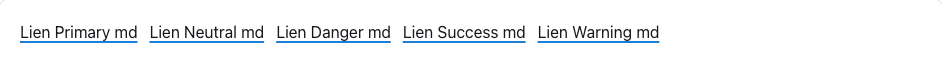
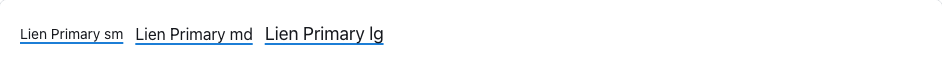
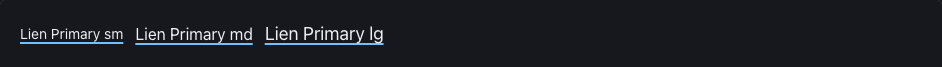
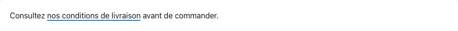
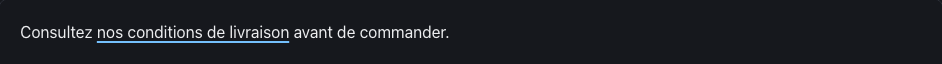
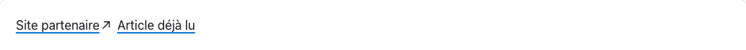
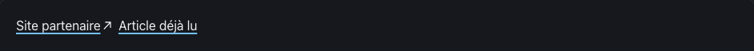
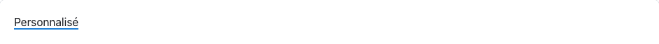

<!-- Généré par tools/docs/reference.mjs depuis packages/core/dist/manifest.json. Ne pas modifier à la main : npm run docs:reference. © 2026 Jonathan KABLAN — Propriétaire. -->

[← Référence](../README.md)

# Composant `link`

Lien texte : `<a class="link" href="…">`. Souligné, focus visible, ton de couleur. Lien externe (target="_blank" ou rel="external") signalé par une flèche décorative ; data-visited distingue les liens déjà visités.

| Propriété | Valeur |
|---|---|
| Classe | `.link` |
| Forme (spec) | `link` |
| Éléments | `<a>` |
| Tons (`data-tone`) | `primary`, `neutral`, `danger`, `success`, `warning` — défaut `primary` |
| Tailles (`data-size`) | `sm`, `md`, `lg` — défaut `md` |
| Parties | — |
| États | `focus` |
| Flutter | `NoraLink` |
| React Native | `NoraLink` |
| Twig Component | `Nora:Link` |

## Usage par cible

### HTML

```html
<a class="link" data-tone="primary" data-size="md" href="#exemples">Lien Primary md</a>
```

### React

```jsx
<a className="link" data-tone="primary" data-size="md" href="#exemples">Lien Primary md</a>
```

### Vue

```vue
<template>
  <a class="link" data-tone="primary" data-size="md" href="#exemples">Lien Primary md</a>
</template>
```

### Twig (Symfony)

```twig
<twig:Nora:Link href="/tarifs">Voir les tarifs</twig:Nora:Link>
```

### Flutter

```dart
NoraLink(
  onPressed: () => ouvrir('/tarifs'),
  child: const Text('Voir les tarifs'),
)
```

### React Native

```tsx
<NoraLink href="https://exemple.ci/tarifs">Voir les tarifs</NoraLink>
```

## Exemples

### Tons

Attribut data-tone : primary, neutral, danger, success, warning (défaut primary).

| Clair | Sombre |
|---|---|
|  |  |

<details><summary>HTML</summary>

```html
<a class="link" data-tone="primary" data-size="md" href="#exemples">Lien Primary md</a>
<a class="link" data-tone="neutral" data-size="md" href="#exemples">Lien Neutral md</a>
<a class="link" data-tone="danger" data-size="md" href="#exemples">Lien Danger md</a>
<a class="link" data-tone="success" data-size="md" href="#exemples">Lien Success md</a>
<a class="link" data-tone="warning" data-size="md" href="#exemples">Lien Warning md</a>
```

</details>

<details><summary>React (JSX)</summary>

```jsx
<a className="link" data-tone="primary" data-size="md" href="#exemples">Lien Primary md</a>
<a className="link" data-tone="neutral" data-size="md" href="#exemples">Lien Neutral md</a>
<a className="link" data-tone="danger" data-size="md" href="#exemples">Lien Danger md</a>
<a className="link" data-tone="success" data-size="md" href="#exemples">Lien Success md</a>
<a className="link" data-tone="warning" data-size="md" href="#exemples">Lien Warning md</a>
```

</details>

### Tailles

Attribut data-size : sm, md, lg (défaut md).

| Clair | Sombre |
|---|---|
|  |  |

<details><summary>HTML</summary>

```html
<a class="link" data-tone="primary" data-size="sm" href="#exemples">Lien Primary sm</a>
<a class="link" data-tone="primary" data-size="md" href="#exemples">Lien Primary md</a>
<a class="link" data-tone="primary" data-size="lg" href="#exemples">Lien Primary lg</a>
```

</details>

<details><summary>React (JSX)</summary>

```jsx
<a className="link" data-tone="primary" data-size="sm" href="#exemples">Lien Primary sm</a>
<a className="link" data-tone="primary" data-size="md" href="#exemples">Lien Primary md</a>
<a className="link" data-tone="primary" data-size="lg" href="#exemples">Lien Primary lg</a>
```

</details>

### Dans un paragraphe

Sans data-size, le lien hérite de la police du texte.

| Clair | Sombre |
|---|---|
|  |  |

<details><summary>HTML</summary>

```html
<p>Consultez <a class="link" href="#exemples">nos conditions de livraison</a> avant de commander.</p>
```

</details>

<details><summary>React (JSX)</summary>

```jsx
<p>Consultez <a className="link" href="#exemples">nos conditions de livraison</a> avant de commander.</p>
```

</details>

### Externe et visité

rel="external" ou target="_blank" : flèche décorative (non lue). data-visited : couleur atténuée une fois visité.

| Clair | Sombre |
|---|---|
|  |  |

<details><summary>HTML</summary>

```html
<p class="cluster"><a class="link" href="#exemples" rel="external">Site partenaire</a> <a class="link" href="#exemples" data-visited>Article déjà lu</a></p>
```

</details>

<details><summary>React (JSX)</summary>

```jsx
<p className="cluster"><a className="link" href="#exemples" rel="external">Site partenaire</a> <a className="link" href="#exemples" data-visited>Article déjà lu</a></p>
```

</details>

## Personnalisation

Tokens du composant, à redéfinir **sur l'élément lui-même** (une valeur posée sur un parent n'est pas héritée, voir [TECHNICAL §4.2](../../TECHNICAL.md#42-trois-niveaux-de-personnalisation)) : `--link-fg`, `--link-visited`, `--link-focus`, `--link-pad-y`, `--link-pad-x`, `--link-font`.

| Clair | Sombre |
|---|---|
|  |  |

```css
.marque-link {
  --link-fg: #0B7285;
}
```

```html
<a class="link marque-link" href="#exemples">Personnalisé</a>
```

## Accessibilité

| Critère | Valeur |
|---|---|
| Rôle | `link` |
| Cible minimale | — |
| Libellé requis | oui |
| Focus visible | oui (anneau `--nora-color-focus`, `:focus-visible`) |
| Mouvement réduit | transitions coupées par `prefers-reduced-motion` |

**Contrôlé par `nora check`** : [`invalid-variant`](../nora-check.md#invalid-variant), [`a11y-anchor-href`](../nora-check.md#a11y-anchor-href), [`a11y-label`](../nora-check.md#a11y-label).
