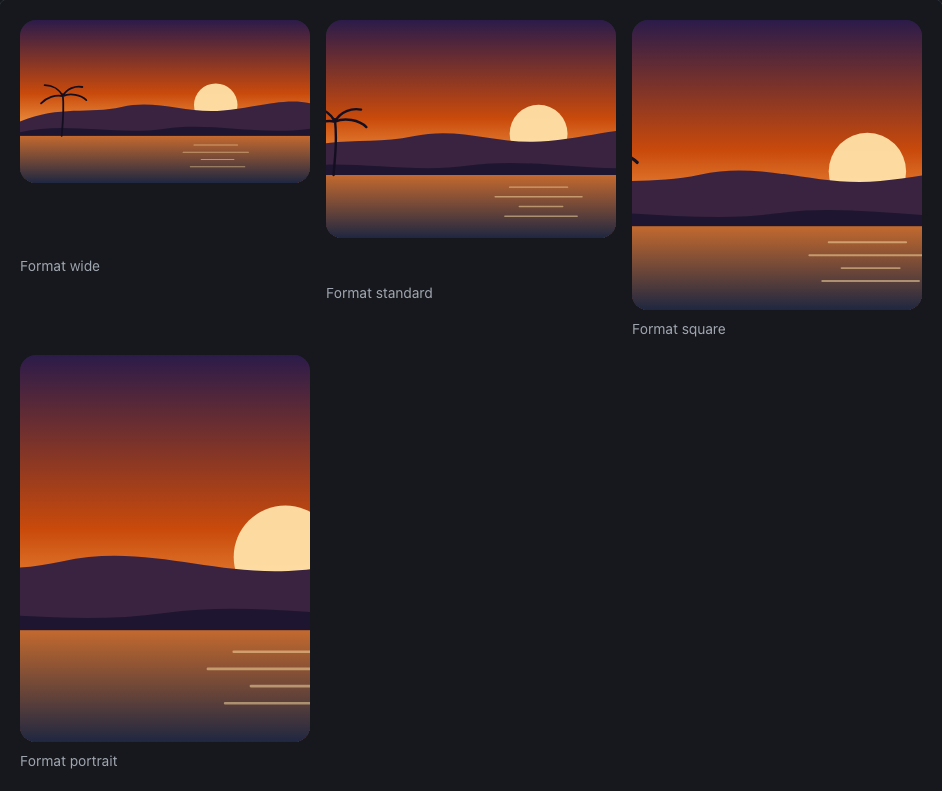
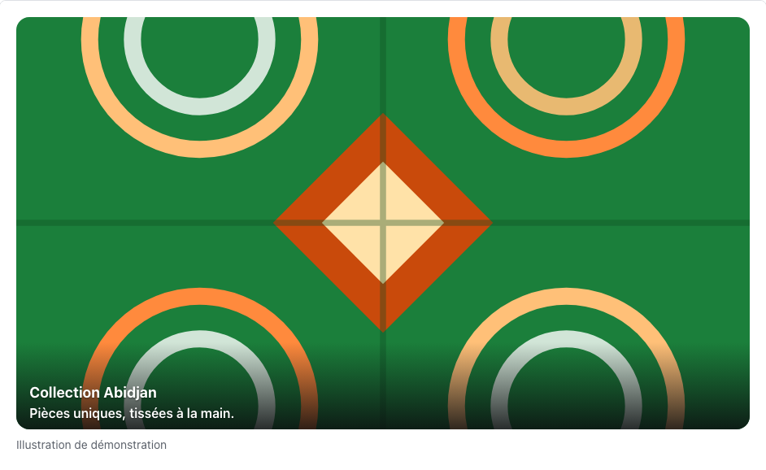
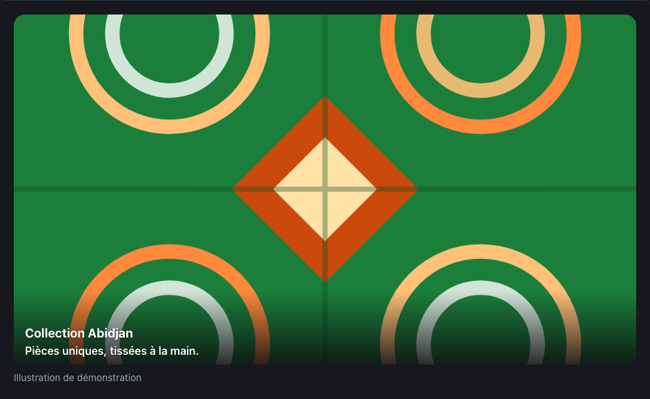
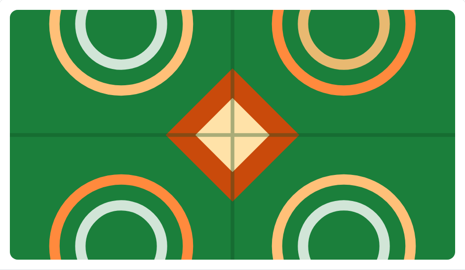
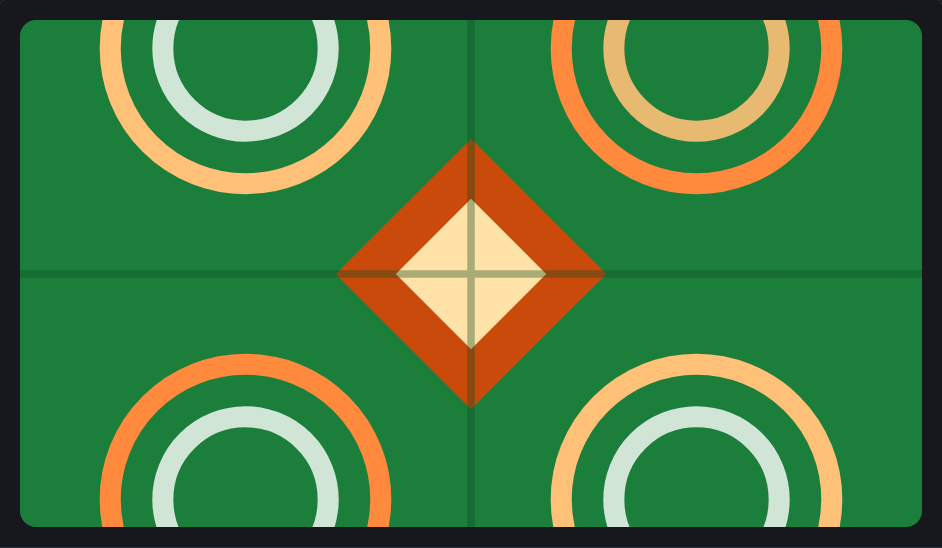
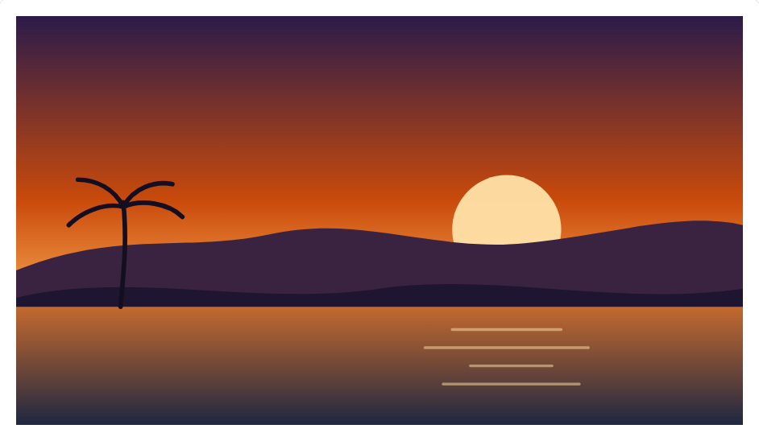
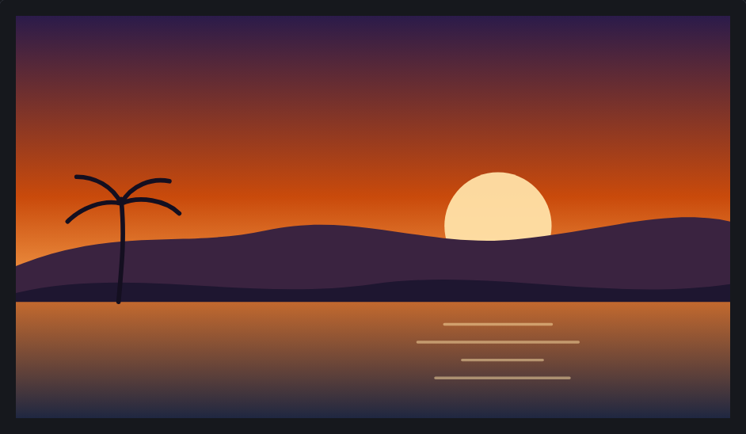

<!-- Généré par tools/docs/reference.mjs depuis packages/core/dist/manifest.json. Ne pas modifier à la main : npm run docs:reference. © 2026 Jonathan KABLAN — Propriétaire. -->

[← Référence](../README.md)

# Composant `media`

Bloc image ou illustration : `<figure class="media" data-size="wide">` avec ``, légende .media-caption (`<figcaption>`) et texte en surimpression .media-overlay (dégradé de lisibilité). data-size fixe le format : wide 16/9, standard 4/3, square 1/1, portrait 3/4.

| Propriété | Valeur |
|---|---|
| Classe | `.media` |
| Forme (spec) | `media` |
| Éléments | `<figure>`, `<div>` |
| Tons (`data-tone`) | `neutral` — défaut `neutral` |
| Tailles (`data-size`) | `wide`, `standard`, `square`, `portrait` — défaut `wide` |
| Parties | `.media-caption`, `.media-overlay` |
| États | — |
| Flutter | `NoraMedia` |
| React Native | `NoraMedia` |
| Twig Component | `Nora:Media` |

## Usage par cible

### HTML

```html
<div class="grid-auto"><figure class="media" data-size="wide"><figcaption class="media-caption">Format wide</figcaption></figure><figure class="media" data-size="standard"><figcaption class="media-caption">Format standard</figcaption></figure><figure class="media" data-size="square"><figcaption class="media-caption">Format square</figcaption></figure><figure class="media" data-size="portrait"><figcaption class="media-caption">Format portrait</figcaption></figure>
</div>
```

### React

```jsx
<div className="grid-auto"><figure className="media" data-size="wide"><figcaption className="media-caption">Format wide</figcaption></figure><figure className="media" data-size="standard"><figcaption className="media-caption">Format standard</figcaption></figure><figure className="media" data-size="square"><figcaption className="media-caption">Format square</figcaption></figure><figure className="media" data-size="portrait"><figcaption className="media-caption">Format portrait</figcaption></figure>
</div>
```

### Vue

```vue
<template>
  <div class="grid-auto"><figure class="media" data-size="wide"><figcaption class="media-caption">Format wide</figcaption></figure><figure class="media" data-size="standard"><figcaption class="media-caption">Format standard</figcaption></figure><figure class="media" data-size="square"><figcaption class="media-caption">Format square</figcaption></figure><figure class="media" data-size="portrait"><figcaption class="media-caption">Format portrait</figcaption></figure>
  </div>
</template>
```

### Twig (Symfony)

```twig
<twig:Nora:Media size="wide">
  
  <figcaption class="media-caption">Photo : équipe NoraIvoire</figcaption>
</twig:Nora:Media>
```

### Flutter

```dart
NoraMedia(
  size: NoraSize.wide,
  overlay: const Text('Grand-Bassam'),
  caption: const Text('Photo : équipe NoraIvoire'),
  child: const Image(image: AssetImage('assets/plage.jpg'), semanticLabel: 'Plage au coucher du soleil', fit: BoxFit.cover),
)
```

### React Native

```tsx
<NoraMedia
  source={require('./plage.jpg')}
  alt="Plage au coucher du soleil"
  overlay="Grand-Bassam"
  caption="Photo : équipe NoraIvoire"
/>
```

## Exemples

### Formats

data-size fixe le format, l'image est recadrée (object-fit: cover) : wide, standard, square, portrait.

| Clair | Sombre |
|---|---|
|  |  |

<details><summary>HTML</summary>

```html
<div class="grid-auto"><figure class="media" data-size="wide"><figcaption class="media-caption">Format wide</figcaption></figure><figure class="media" data-size="standard"><figcaption class="media-caption">Format standard</figcaption></figure><figure class="media" data-size="square"><figcaption class="media-caption">Format square</figcaption></figure><figure class="media" data-size="portrait"><figcaption class="media-caption">Format portrait</figcaption></figure>
</div>
```

</details>

<details><summary>React (JSX)</summary>

```jsx
<div className="grid-auto"><figure className="media" data-size="wide"><figcaption className="media-caption">Format wide</figcaption></figure><figure className="media" data-size="standard"><figcaption className="media-caption">Format standard</figcaption></figure><figure className="media" data-size="square"><figcaption className="media-caption">Format square</figcaption></figure><figure className="media" data-size="portrait"><figcaption className="media-caption">Format portrait</figcaption></figure>
</div>
```

</details>

### Texte en surimpression

.media-overlay : dégradé de lisibilité sous le texte, lisible sur toute image.

| Clair | Sombre |
|---|---|
|  |  |

<details><summary>HTML</summary>

```html
<figure class="media" data-size="wide">
<div class="media-overlay">
  <p class="text-lg font-bold">Collection Abidjan</p>
  <p>Pièces uniques, tissées à la main.</p>
</div><figcaption class="media-caption">Illustration de démonstration</figcaption></figure>
```

</details>

<details><summary>React (JSX)</summary>

```jsx
<figure className="media" data-size="wide">
<div className="media-overlay">
  <p className="text-lg font-bold">Collection Abidjan</p>
  <p>Pièces uniques, tissées à la main.</p>
</div><figcaption className="media-caption">Illustration de démonstration</figcaption></figure>
```

</details>

### Avec un effet

Tout effet s'applique au bloc, par exemple data-fx="tilt" (coupé en mouvement réduit).

| Clair | Sombre |
|---|---|
|  |  |

<details><summary>HTML</summary>

```html
<figure class="media" data-size="wide" data-fx="tilt"></figure>
```

</details>

<details><summary>React (JSX)</summary>

```jsx
<figure className="media" data-size="wide" data-fx="tilt"></figure>
```

</details>

## Personnalisation

Tokens du composant, à redéfinir **sur l'élément lui-même** (une valeur posée sur un parent n'est pas héritée, voir [TECHNICAL §4.2](../../TECHNICAL.md#42-trois-niveaux-de-personnalisation)) : `--media-bg`, `--media-fg`, `--media-radius`, `--media-scrim`, `--media-on-scrim`, `--media-pad-y`, `--media-pad-x`, `--media-font`, `--media-ratio`.

| Clair | Sombre |
|---|---|
|  |  |

```css
.marque-media {
  --media-radius: 0px;
  --media-fg: #0B7285;
}
```

```html
<figure class="media marque-media"></figure>
```

## Accessibilité

| Critère | Valeur |
|---|---|
| Rôle | `figure` |
| Cible minimale | — |
| Libellé requis | oui |
| Focus visible | sans objet |
| Mouvement réduit | transitions coupées par `prefers-reduced-motion` |

**Contrôlé par `nora check`** : [`invalid-variant`](../nora-check.md#invalid-variant), [`a11y-img-alt`](../nora-check.md#a11y-img-alt).
