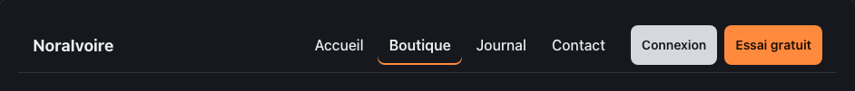
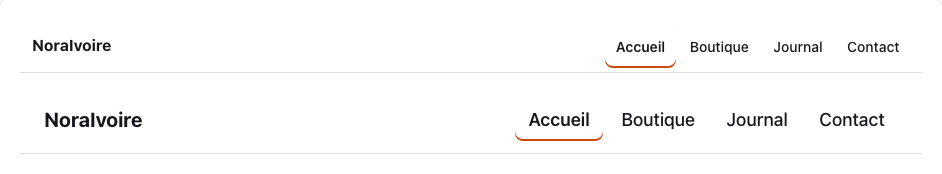
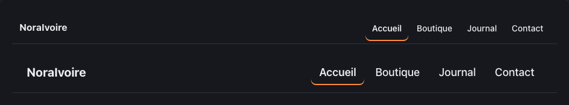

<!-- Généré par tools/docs/reference.mjs depuis packages/core/dist/manifest.json. Ne pas modifier à la main : npm run docs:reference. © 2026 Jonathan KABLAN — Propriétaire. -->

[← Référence](../README.md)

# Composant `navbar`

Barre de navigation : `<nav class="navbar" aria-label="…">` avec .navbar-brand, une liste .navbar-menu de liens (page courante : aria-current="page") et .navbar-actions. Sans JavaScript : sur petit écran, le menu passe sous la marque et défile horizontalement.

| Propriété | Valeur |
|---|---|
| Classe | `.navbar` |
| Forme (spec) | `nav` |
| Éléments | `<nav>` |
| Tons (`data-tone`) | `neutral` — défaut `neutral` |
| Tailles (`data-size`) | `sm`, `md`, `lg` — défaut `md` |
| Parties | `.navbar-brand`, `.navbar-menu`, `.navbar-actions` |
| États | `focus` |
| Flutter | `NoraNavbar` |
| React Native | `NoraNavbar` |
| Twig Component | `Nora:Navbar` |

## Usage par cible

### HTML

```html
<nav class="navbar" aria-label="Exemple principal">
<a class="navbar-brand" href="#exemples">NoraIvoire</a>
<ul class="navbar-menu">
  <li>
    <a href="#exemples">Accueil</a>
  </li>
  <li>
    <a href="#exemples" aria-current="page">Boutique</a>
  </li>
  <li>
    <a href="#exemples">Journal</a>
  </li>
  <li>
    <a href="#exemples">Contact</a>
  </li>
</ul>
<div class="navbar-actions">
  <a class="btn" data-tone="neutral" data-size="sm" href="#exemples">Connexion</a>
  <a class="btn" data-size="sm" href="#exemples">Essai gratuit</a>
</div></nav>
```

### React

```jsx
<nav className="navbar" aria-label="Exemple principal">
<a className="navbar-brand" href="#exemples">NoraIvoire</a>
<ul className="navbar-menu">
  <li>
    <a href="#exemples">Accueil</a>
  </li>
  <li>
    <a href="#exemples" aria-current="page">Boutique</a>
  </li>
  <li>
    <a href="#exemples">Journal</a>
  </li>
  <li>
    <a href="#exemples">Contact</a>
  </li>
</ul>
<div className="navbar-actions">
  <a className="btn" data-tone="neutral" data-size="sm" href="#exemples">Connexion</a>
  <a className="btn" data-size="sm" href="#exemples">Essai gratuit</a>
</div></nav>
```

### Vue

```vue
<template>
  <nav class="navbar" aria-label="Exemple principal">
  <a class="navbar-brand" href="#exemples">NoraIvoire</a>
  <ul class="navbar-menu">
    <li>
      <a href="#exemples">Accueil</a>
    </li>
    <li>
      <a href="#exemples" aria-current="page">Boutique</a>
    </li>
    <li>
      <a href="#exemples">Journal</a>
    </li>
    <li>
      <a href="#exemples">Contact</a>
    </li>
  </ul>
  <div class="navbar-actions">
    <a class="btn" data-tone="neutral" data-size="sm" href="#exemples">Connexion</a>
    <a class="btn" data-size="sm" href="#exemples">Essai gratuit</a>
  </div></nav>
</template>
```

### Twig (Symfony)

```twig
<twig:Nora:Navbar aria-label="Principale">
  <a class="navbar-brand" href="/">NoraIvoire</a>
  <ul class="navbar-menu"><li><a href="/" aria-current="page">Accueil</a></li></ul>
</twig:Nora:Navbar>
```

### Flutter

```dart
NoraNavbar(
  label: 'Principale',
  brand: const Text('NoraIvoire'),
  items: [
    NoraNavbarItem(label: 'Accueil', current: true, onTap: () {}),
    NoraNavbarItem(label: 'Boutique', onTap: () {}),
  ],
  actions: [NoraBtn(size: NoraSize.sm, onPressed: () {}, child: const Text('Connexion'))],
)
```

### React Native

```tsx
<NoraNavbar
  label="Principale"
  brand="NoraIvoire"
  items={[{ label: 'Accueil', current: true, href: '/' }, { label: 'Boutique', href: '/boutique' }]}
  actions={<NoraBtn size="sm">Connexion</NoraBtn>}
/>
```

## Exemples

### Barre complète

Marque, menu (page courante : aria-current="page") et actions. Réduisez la fenêtre : le menu passe sous la marque et défile, sans JavaScript.

| Clair | Sombre |
|---|---|
|  |  |

<details><summary>HTML</summary>

```html
<nav class="navbar" aria-label="Exemple principal">
<a class="navbar-brand" href="#exemples">NoraIvoire</a>
<ul class="navbar-menu">
  <li>
    <a href="#exemples">Accueil</a>
  </li>
  <li>
    <a href="#exemples" aria-current="page">Boutique</a>
  </li>
  <li>
    <a href="#exemples">Journal</a>
  </li>
  <li>
    <a href="#exemples">Contact</a>
  </li>
</ul>
<div class="navbar-actions">
  <a class="btn" data-tone="neutral" data-size="sm" href="#exemples">Connexion</a>
  <a class="btn" data-size="sm" href="#exemples">Essai gratuit</a>
</div></nav>
```

</details>

<details><summary>React (JSX)</summary>

```jsx
<nav className="navbar" aria-label="Exemple principal">
<a className="navbar-brand" href="#exemples">NoraIvoire</a>
<ul className="navbar-menu">
  <li>
    <a href="#exemples">Accueil</a>
  </li>
  <li>
    <a href="#exemples" aria-current="page">Boutique</a>
  </li>
  <li>
    <a href="#exemples">Journal</a>
  </li>
  <li>
    <a href="#exemples">Contact</a>
  </li>
</ul>
<div className="navbar-actions">
  <a className="btn" data-tone="neutral" data-size="sm" href="#exemples">Connexion</a>
  <a className="btn" data-size="sm" href="#exemples">Essai gratuit</a>
</div></nav>
```

</details>

### Tailles

data-size : sm, md, lg.

| Clair | Sombre |
|---|---|
|  |  |

<details><summary>HTML</summary>

```html
<nav class="navbar" data-size="sm" aria-label="Exemple sm">
<a class="navbar-brand" href="#exemples">NoraIvoire</a>
<ul class="navbar-menu">
  <li>
    <a href="#exemples" aria-current="page">Accueil</a>
  </li>
  <li>
    <a href="#exemples">Boutique</a>
  </li>
  <li>
    <a href="#exemples">Journal</a>
  </li>
  <li>
    <a href="#exemples">Contact</a>
  </li>
</ul></nav><nav class="navbar" data-size="lg" aria-label="Exemple lg">
<a class="navbar-brand" href="#exemples">NoraIvoire</a>
<ul class="navbar-menu">
  <li>
    <a href="#exemples" aria-current="page">Accueil</a>
  </li>
  <li>
    <a href="#exemples">Boutique</a>
  </li>
  <li>
    <a href="#exemples">Journal</a>
  </li>
  <li>
    <a href="#exemples">Contact</a>
  </li>
</ul></nav>
```

</details>

<details><summary>React (JSX)</summary>

```jsx
<nav className="navbar" data-size="sm" aria-label="Exemple sm">
<a className="navbar-brand" href="#exemples">NoraIvoire</a>
<ul className="navbar-menu">
  <li>
    <a href="#exemples" aria-current="page">Accueil</a>
  </li>
  <li>
    <a href="#exemples">Boutique</a>
  </li>
  <li>
    <a href="#exemples">Journal</a>
  </li>
  <li>
    <a href="#exemples">Contact</a>
  </li>
</ul></nav><nav className="navbar" data-size="lg" aria-label="Exemple lg">
<a className="navbar-brand" href="#exemples">NoraIvoire</a>
<ul className="navbar-menu">
  <li>
    <a href="#exemples" aria-current="page">Accueil</a>
  </li>
  <li>
    <a href="#exemples">Boutique</a>
  </li>
  <li>
    <a href="#exemples">Journal</a>
  </li>
  <li>
    <a href="#exemples">Contact</a>
  </li>
</ul></nav>
```

</details>

## Personnalisation

Tokens du composant, à redéfinir **sur l'élément lui-même** (une valeur posée sur un parent n'est pas héritée, voir [TECHNICAL §4.2](../../TECHNICAL.md#42-trois-niveaux-de-personnalisation)) : `--navbar-bg`, `--navbar-fg`, `--navbar-muted`, `--navbar-border`, `--navbar-active`, `--navbar-focus`, `--navbar-pad-y`, `--navbar-pad-x`, `--navbar-font`.

## Accessibilité

| Critère | Valeur |
|---|---|
| Rôle | `navigation` |
| Cible minimale | 44 px |
| Libellé requis | oui |
| Focus visible | oui (anneau `--nora-color-focus`, `:focus-visible`) |
| Mouvement réduit | transitions coupées par `prefers-reduced-motion` |

**Contrôlé par `nora check`** : [`a11y-nav-label`](../nora-check.md#a11y-nav-label), [`a11y-nav-current`](../nora-check.md#a11y-nav-current).
