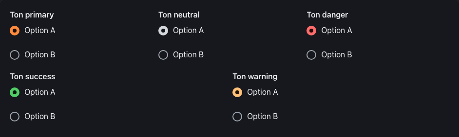
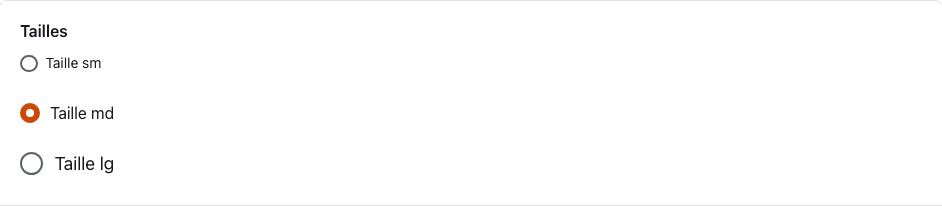
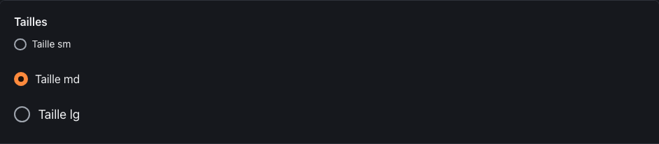
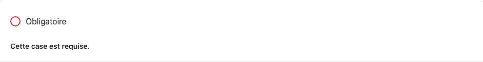
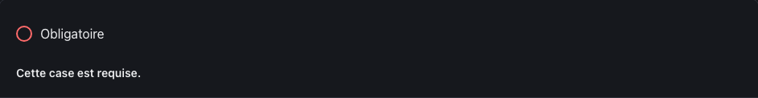
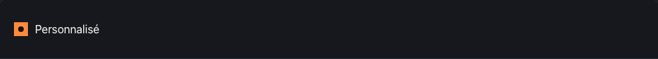

<!-- Généré par tools/docs/reference.mjs depuis packages/core/dist/manifest.json. Ne pas modifier à la main : npm run docs:reference. © 2026 Jonathan KABLAN — Propriétaire. -->

[← Référence](../README.md)

# Composant `radio`

Bouton radio : un `<label class="radio">` contenant `<input type="radio" name="…">` et son texte (zone cliquable ≥ 44 px). Grouper les options d'une même question dans un `<fieldset class="field">` avec `<legend class="field-label">`.

| Propriété | Valeur |
|---|---|
| Classe | `.radio` |
| Forme (spec) | `toggle` |
| Éléments | `<label>` |
| Tons (`data-tone`) | `primary`, `neutral`, `danger`, `success`, `warning` — défaut `primary` |
| Tailles (`data-size`) | `sm`, `md`, `lg` — défaut `md` |
| Parties | — |
| États | `focus`, `invalid`, `disabled` |
| Flutter | `NoraRadio` |
| React Native | `NoraRadio` |
| Twig Component | `Nora:Radio` |

## Usage par cible

### HTML

```html
<fieldset class="field">
  <legend class="field-label">Ton primary</legend>
  <label class="radio" data-tone="primary" data-size="md"><input type="radio" name="grp-primary" checked> Option A</label>
  <label class="radio" data-tone="primary" data-size="md"><input type="radio" name="grp-primary"> Option B</label>
</fieldset>
```

### React

```jsx
<fieldset className="field">
  <legend className="field-label">Ton primary</legend>
  <label className="radio" data-tone="primary" data-size="md"><input type="radio" name="grp-primary" defaultChecked /> Option A</label>
  <label className="radio" data-tone="primary" data-size="md"><input type="radio" name="grp-primary" /> Option B</label>
</fieldset>
```

### Vue

```vue
<template>
  <fieldset class="field">
    <legend class="field-label">Ton primary</legend>
    <label class="radio" data-tone="primary" data-size="md"><input type="radio" name="grp-primary" checked> Option A</label>
    <label class="radio" data-tone="primary" data-size="md"><input type="radio" name="grp-primary"> Option B</label>
  </fieldset>
</template>
```

### Twig (Symfony)

```twig
<twig:Nora:Radio><input type="radio" name="choix"> Libellé</twig:Nora:Radio>
```

### Flutter

```dart
NoraRadioGroup<String>(
  groupValue: livraison,
  onChanged: (v) => setState(() => livraison = v),
  child: const Column(children: [
    NoraRadio(value: 'standard', child: Text('Standard')),
    NoraRadio(value: 'express', child: Text('Express')),
  ]),
)
```

### React Native

```tsx
<NoraRadioGroup value={livraison} onChange={setLivraison}>
  <NoraRadio value="standard">Standard</NoraRadio>
  <NoraRadio value="express">Express</NoraRadio>
</NoraRadioGroup>
```

## Exemples

### Tons

Un groupe par question (même name), dans un fieldset avec legend. data-tone : primary, neutral, danger, success, warning.

| Clair | Sombre |
|---|---|
|  |  |

<details><summary>HTML</summary>

```html
<fieldset class="field">
  <legend class="field-label">Ton primary</legend>
  <label class="radio" data-tone="primary" data-size="md"><input type="radio" name="grp-primary" checked> Option A</label>
  <label class="radio" data-tone="primary" data-size="md"><input type="radio" name="grp-primary"> Option B</label>
</fieldset>
<fieldset class="field">
  <legend class="field-label">Ton neutral</legend>
  <label class="radio" data-tone="neutral" data-size="md"><input type="radio" name="grp-neutral" checked> Option A</label>
  <label class="radio" data-tone="neutral" data-size="md"><input type="radio" name="grp-neutral"> Option B</label>
</fieldset>
<fieldset class="field">
  <legend class="field-label">Ton danger</legend>
  <label class="radio" data-tone="danger" data-size="md"><input type="radio" name="grp-danger" checked> Option A</label>
  <label class="radio" data-tone="danger" data-size="md"><input type="radio" name="grp-danger"> Option B</label>
</fieldset>
<fieldset class="field">
  <legend class="field-label">Ton success</legend>
  <label class="radio" data-tone="success" data-size="md"><input type="radio" name="grp-success" checked> Option A</label>
  <label class="radio" data-tone="success" data-size="md"><input type="radio" name="grp-success"> Option B</label>
</fieldset>
<fieldset class="field">
  <legend class="field-label">Ton warning</legend>
  <label class="radio" data-tone="warning" data-size="md"><input type="radio" name="grp-warning" checked> Option A</label>
  <label class="radio" data-tone="warning" data-size="md"><input type="radio" name="grp-warning"> Option B</label>
</fieldset>
```

</details>

<details><summary>React (JSX)</summary>

```jsx
<fieldset className="field">
  <legend className="field-label">Ton primary</legend>
  <label className="radio" data-tone="primary" data-size="md"><input type="radio" name="grp-primary" defaultChecked /> Option A</label>
  <label className="radio" data-tone="primary" data-size="md"><input type="radio" name="grp-primary" /> Option B</label>
</fieldset>
<fieldset className="field">
  <legend className="field-label">Ton neutral</legend>
  <label className="radio" data-tone="neutral" data-size="md"><input type="radio" name="grp-neutral" defaultChecked /> Option A</label>
  <label className="radio" data-tone="neutral" data-size="md"><input type="radio" name="grp-neutral" /> Option B</label>
</fieldset>
<fieldset className="field">
  <legend className="field-label">Ton danger</legend>
  <label className="radio" data-tone="danger" data-size="md"><input type="radio" name="grp-danger" defaultChecked /> Option A</label>
  <label className="radio" data-tone="danger" data-size="md"><input type="radio" name="grp-danger" /> Option B</label>
</fieldset>
<fieldset className="field">
  <legend className="field-label">Ton success</legend>
  <label className="radio" data-tone="success" data-size="md"><input type="radio" name="grp-success" defaultChecked /> Option A</label>
  <label className="radio" data-tone="success" data-size="md"><input type="radio" name="grp-success" /> Option B</label>
</fieldset>
<fieldset className="field">
  <legend className="field-label">Ton warning</legend>
  <label className="radio" data-tone="warning" data-size="md"><input type="radio" name="grp-warning" defaultChecked /> Option A</label>
  <label className="radio" data-tone="warning" data-size="md"><input type="radio" name="grp-warning" /> Option B</label>
</fieldset>
```

</details>

### Tailles

data-size : sm, md, lg.

| Clair | Sombre |
|---|---|
|  |  |

<details><summary>HTML</summary>

```html
<fieldset class="field">
  <legend class="field-label">Tailles</legend>
  <label class="radio" data-tone="primary" data-size="sm"><input type="radio" name="grp-tailles"> Taille sm</label>
  <label class="radio" data-tone="primary" data-size="md"><input type="radio" name="grp-tailles" checked> Taille md</label>
  <label class="radio" data-tone="primary" data-size="lg"><input type="radio" name="grp-tailles"> Taille lg</label>
</fieldset>
```

</details>

<details><summary>React (JSX)</summary>

```jsx
<fieldset className="field">
  <legend className="field-label">Tailles</legend>
  <label className="radio" data-tone="primary" data-size="sm"><input type="radio" name="grp-tailles" /> Taille sm</label>
  <label className="radio" data-tone="primary" data-size="md"><input type="radio" name="grp-tailles" defaultChecked /> Taille md</label>
  <label className="radio" data-tone="primary" data-size="lg"><input type="radio" name="grp-tailles" /> Taille lg</label>
</fieldset>
```

</details>

### Invalide

aria-invalid="true" sur l'input, relié au message.

| Clair | Sombre |
|---|---|
|  |  |

<details><summary>HTML</summary>

```html
<div class="stack">
  <label class="radio" data-tone="primary"><input type="radio" name="radio-err-1" aria-invalid="true" aria-describedby="radio-err-1-msg"> Obligatoire</label>
  <p class="field-error" id="radio-err-1-msg">Cette case est requise.</p>
</div>
```

</details>

<details><summary>React (JSX)</summary>

```jsx
<div className="stack">
  <label className="radio" data-tone="primary"><input type="radio" name="radio-err-1" aria-invalid="true" aria-describedby="radio-err-1-msg" /> Obligatoire</label>
  <p className="field-error" id="radio-err-1-msg">Cette case est requise.</p>
</div>
```

</details>

### Désactivé

Attribut natif disabled sur l'input.

| Clair | Sombre |
|---|---|
|  |  |

<details><summary>HTML</summary>

```html
<label class="radio" data-tone="primary" data-size="md"><input type="radio" name="radio-off" disabled> Indisponible</label>
```

</details>

<details><summary>React (JSX)</summary>

```jsx
<label className="radio" data-tone="primary" data-size="md"><input type="radio" name="radio-off" disabled /> Indisponible</label>
```

</details>

## Personnalisation

Tokens du composant, à redéfinir **sur l'élément lui-même** (une valeur posée sur un parent n'est pas héritée, voir [TECHNICAL §4.2](../../TECHNICAL.md#42-trois-niveaux-de-personnalisation)) : `--radio-bg`, `--radio-fg`, `--radio-radius`, `--radio-border`, `--radio-accent`, `--radio-on-accent`, `--radio-focus`, `--radio-invalid`, `--radio-pad-y`, `--radio-pad-x`, `--radio-font`.

| Clair | Sombre |
|---|---|
|  |  |

```css
.marque-radio {
  --radio-radius: 0px;
  --radio-bg: #0B7285;
  --radio-fg: #FFFFFF;
}
```

```html
<label class="radio marque-radio"><input type="radio" name="marque-radio" checked> Personnalisé</label>
```

## Accessibilité

| Critère | Valeur |
|---|---|
| Rôle | `radio` |
| Cible minimale | 44 px |
| Libellé requis | oui |
| Focus visible | oui (anneau `--nora-color-focus`, `:focus-visible`) |
| Mouvement réduit | transitions coupées par `prefers-reduced-motion` |

**Contrôlé par `nora check`** : [`invalid-variant`](../nora-check.md#invalid-variant), [`a11y-toggle-input`](../nora-check.md#a11y-toggle-input), [`a11y-form-label`](../nora-check.md#a11y-form-label).
