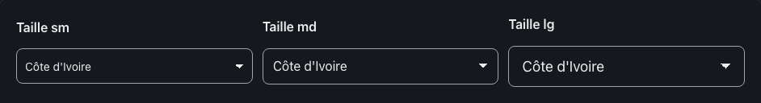
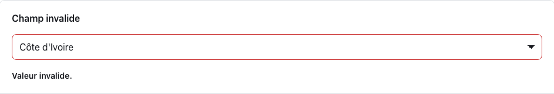
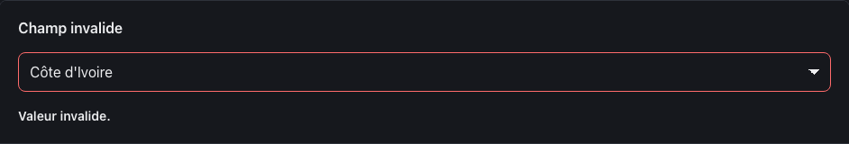
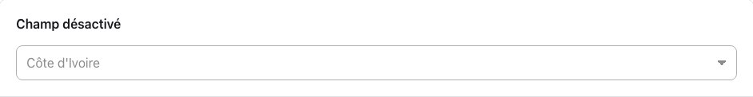
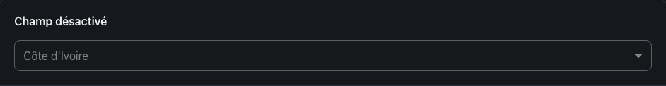
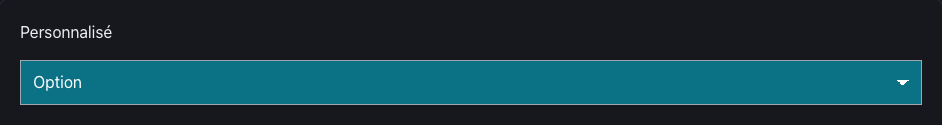

<!-- Généré par tools/docs/reference.mjs depuis packages/core/dist/manifest.json. Ne pas modifier à la main : npm run docs:reference. © 2026 Jonathan KABLAN — Propriétaire. -->

[← Référence](../README.md)

# Composant `select`

Liste de choix native. Toujours associée à un `<label for>`.

| Propriété | Valeur |
|---|---|
| Classe | `.select` |
| Forme (spec) | `control` |
| Éléments | `<select>` |
| Tons (`data-tone`) | `neutral` — défaut `neutral` |
| Tailles (`data-size`) | `sm`, `md`, `lg` — défaut `md` |
| Parties | — |
| États | `focus`, `invalid`, `disabled` |
| Flutter | `NoraSelect` |
| React Native | `NoraSelect` |
| Twig Component | `Nora:Select` |

## Usage par cible

### HTML

```html
<div class="stack">
  <label class="field-label" for="select-sm-1">Taille sm</label>
  <select class="select" id="select-sm-1" name="select-sm-1" data-size="sm"><option>Côte d'Ivoire</option><option>Sénégal</option></select>
</div>
```

### React

```jsx
<div className="stack">
  <label className="field-label" htmlFor="select-sm-1">Taille sm</label>
  <select className="select" id="select-sm-1" name="select-sm-1" data-size="sm"><option>Côte d'Ivoire</option><option>Sénégal</option></select>
</div>
```

### Vue

```vue
<template>
  <div class="stack">
    <label class="field-label" for="select-sm-1">Taille sm</label>
    <select class="select" id="select-sm-1" name="select-sm-1" data-size="sm"><option>Côte d'Ivoire</option><option>Sénégal</option></select>
  </div>
</template>
```

### Twig (Symfony)

```twig
<twig:Nora:Field id="champ" label="Libellé">
  <twig:Nora:Select {{ ...control }} />
</twig:Nora:Field>
```

### Flutter

```dart
NoraSelect<String>(
  value: pays,
  items: const [DropdownMenuItem(value: 'ci', child: Text("Côte d'Ivoire"))],
  onChanged: (v) => setState(() => pays = v),
)
```

### React Native

```tsx
<NoraSelect
  options={[{ value: 'ci', label: "Côte d'Ivoire" }]}
  value={pays}
  onChange={setPays}
/>
```

## Exemples

### Tailles

Toujours associé à un libellé (`<label for>`). data-size : sm, md, lg.

| Clair | Sombre |
|---|---|
|  |  |

<details><summary>HTML</summary>

```html
<div class="stack">
  <label class="field-label" for="select-sm-1">Taille sm</label>
  <select class="select" id="select-sm-1" name="select-sm-1" data-size="sm"><option>Côte d'Ivoire</option><option>Sénégal</option></select>
</div>
<div class="stack">
  <label class="field-label" for="select-md-2">Taille md</label>
  <select class="select" id="select-md-2" name="select-md-2" data-size="md"><option>Côte d'Ivoire</option><option>Sénégal</option></select>
</div>
<div class="stack">
  <label class="field-label" for="select-lg-3">Taille lg</label>
  <select class="select" id="select-lg-3" name="select-lg-3" data-size="lg"><option>Côte d'Ivoire</option><option>Sénégal</option></select>
</div>
```

</details>

<details><summary>React (JSX)</summary>

```jsx
<div className="stack">
  <label className="field-label" htmlFor="select-sm-1">Taille sm</label>
  <select className="select" id="select-sm-1" name="select-sm-1" data-size="sm"><option>Côte d'Ivoire</option><option>Sénégal</option></select>
</div>
<div className="stack">
  <label className="field-label" htmlFor="select-md-2">Taille md</label>
  <select className="select" id="select-md-2" name="select-md-2" data-size="md"><option>Côte d'Ivoire</option><option>Sénégal</option></select>
</div>
<div className="stack">
  <label className="field-label" htmlFor="select-lg-3">Taille lg</label>
  <select className="select" id="select-lg-3" name="select-lg-3" data-size="lg"><option>Côte d'Ivoire</option><option>Sénégal</option></select>
</div>
```

</details>

### Invalide

aria-invalid="true" relié au message par aria-describedby.

| Clair | Sombre |
|---|---|
|  |  |

<details><summary>HTML</summary>

```html
<div class="stack">
  <label class="field-label" for="select-invalide-4">Champ invalide</label>
  <select class="select" id="select-invalide-4" name="select-invalide-4" aria-invalid="true" aria-describedby="select-invalide-4-erreur"><option>Côte d'Ivoire</option><option>Sénégal</option></select>
  <p class="field-error" id="select-invalide-4-erreur">Valeur invalide.</p>
</div>
```

</details>

<details><summary>React (JSX)</summary>

```jsx
<div className="stack">
  <label className="field-label" htmlFor="select-invalide-4">Champ invalide</label>
  <select className="select" id="select-invalide-4" name="select-invalide-4" aria-invalid="true" aria-describedby="select-invalide-4-erreur"><option>Côte d'Ivoire</option><option>Sénégal</option></select>
  <p className="field-error" id="select-invalide-4-erreur">Valeur invalide.</p>
</div>
```

</details>

### Désactivé

Attribut natif disabled.

| Clair | Sombre |
|---|---|
|  |  |

<details><summary>HTML</summary>

```html
<div class="stack">
  <label class="field-label" for="select-off-5">Champ désactivé</label>
  <select class="select" id="select-off-5" name="select-off-5" disabled><option>Côte d'Ivoire</option><option>Sénégal</option></select>
</div>
```

</details>

<details><summary>React (JSX)</summary>

```jsx
<div className="stack">
  <label className="field-label" htmlFor="select-off-5">Champ désactivé</label>
  <select className="select" id="select-off-5" name="select-off-5" disabled><option>Côte d'Ivoire</option><option>Sénégal</option></select>
</div>
```

</details>

## Personnalisation

Tokens du composant, à redéfinir **sur l'élément lui-même** (une valeur posée sur un parent n'est pas héritée, voir [TECHNICAL §4.2](../../TECHNICAL.md#42-trois-niveaux-de-personnalisation)) : `--select-bg`, `--select-fg`, `--select-radius`, `--select-border`, `--select-muted`, `--select-focus`, `--select-invalid`, `--select-pad-y`, `--select-pad-x`, `--select-font`.

| Clair | Sombre |
|---|---|
|  |  |

```css
.marque-select {
  --select-radius: 0px;
  --select-bg: #0B7285;
  --select-fg: #FFFFFF;
}
```

```html
<div class="stack">
  <label for="marque-select">Personnalisé</label>
  <select class="select marque-select" id="marque-select"><option>Option</option></select>
</div>
```

## Accessibilité

| Critère | Valeur |
|---|---|
| Rôle | `combobox` |
| Cible minimale | 44 px |
| Libellé requis | oui |
| Focus visible | oui (anneau `--nora-color-focus`, `:focus-visible`) |
| Mouvement réduit | transitions coupées par `prefers-reduced-motion` |

**Contrôlé par `nora check`** : [`invalid-variant`](../nora-check.md#invalid-variant), [`a11y-form-label`](../nora-check.md#a11y-form-label), [`a11y-invalid-message`](../nora-check.md#a11y-invalid-message).
