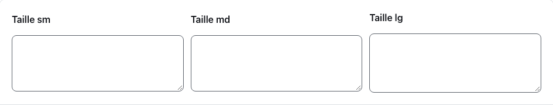
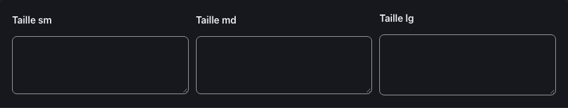
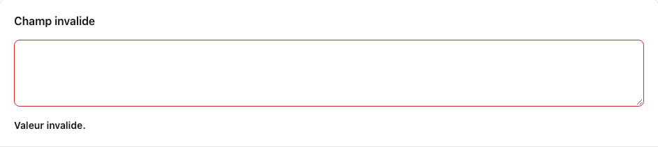
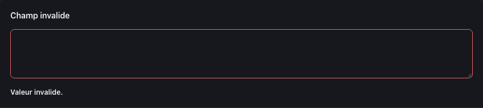
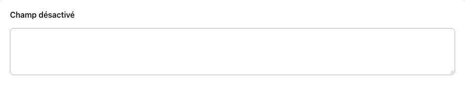
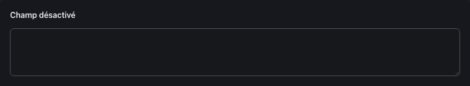
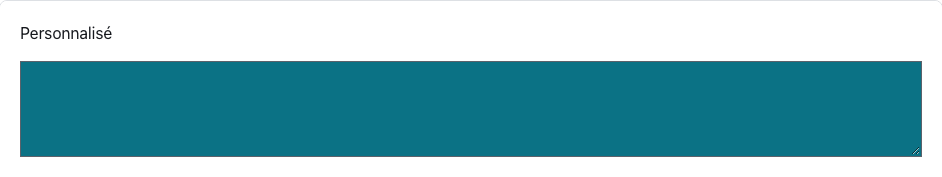
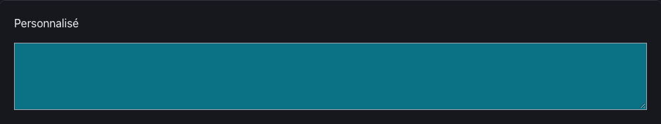

<!-- Généré par tools/docs/reference.mjs depuis packages/core/dist/manifest.json. Ne pas modifier à la main : npm run docs:reference. © 2026 Jonathan KABLAN — Propriétaire. -->

[← Référence](../README.md)

# Composant `textarea`

Zone de texte sur plusieurs lignes, redimensionnable verticalement. Toujours associée à un `<label for>`.

| Propriété | Valeur |
|---|---|
| Classe | `.textarea` |
| Forme (spec) | `control` |
| Éléments | `<textarea>` |
| Tons (`data-tone`) | `neutral` — défaut `neutral` |
| Tailles (`data-size`) | `sm`, `md`, `lg` — défaut `md` |
| Parties | — |
| États | `focus`, `invalid`, `disabled` |
| Flutter | `NoraTextarea` |
| React Native | `NoraTextarea` |
| Twig Component | `Nora:Textarea` |

## Usage par cible

### HTML

```html
<div class="stack">
  <label class="field-label" for="textarea-sm-1">Taille sm</label>
  <textarea class="textarea" id="textarea-sm-1" name="textarea-sm-1" rows="3" data-size="sm"></textarea>
</div>
```

### React

```jsx
<div className="stack">
  <label className="field-label" htmlFor="textarea-sm-1">Taille sm</label>
  <textarea className="textarea" id="textarea-sm-1" name="textarea-sm-1" rows="3" data-size="sm"></textarea>
</div>
```

### Vue

```vue
<template>
  <div class="stack">
    <label class="field-label" for="textarea-sm-1">Taille sm</label>
    <textarea class="textarea" id="textarea-sm-1" name="textarea-sm-1" rows="3" data-size="sm"></textarea>
  </div>
</template>
```

### Twig (Symfony)

```twig
<twig:Nora:Field id="champ" label="Libellé">
  <twig:Nora:Textarea {{ ...control }} />
</twig:Nora:Field>
```

### Flutter

```dart
NoraTextarea(
  hint: 'Votre réponse',
  onChanged: (v) {},
)
```

### React Native

```tsx
<NoraTextarea label="Votre réponse" onChangeText={setValeur} />
```

## Exemples

### Tailles

Toujours associé à un libellé (`<label for>`). data-size : sm, md, lg.

| Clair | Sombre |
|---|---|
|  |  |

<details><summary>HTML</summary>

```html
<div class="stack">
  <label class="field-label" for="textarea-sm-1">Taille sm</label>
  <textarea class="textarea" id="textarea-sm-1" name="textarea-sm-1" rows="3" data-size="sm"></textarea>
</div>
<div class="stack">
  <label class="field-label" for="textarea-md-2">Taille md</label>
  <textarea class="textarea" id="textarea-md-2" name="textarea-md-2" rows="3" data-size="md"></textarea>
</div>
<div class="stack">
  <label class="field-label" for="textarea-lg-3">Taille lg</label>
  <textarea class="textarea" id="textarea-lg-3" name="textarea-lg-3" rows="3" data-size="lg"></textarea>
</div>
```

</details>

<details><summary>React (JSX)</summary>

```jsx
<div className="stack">
  <label className="field-label" htmlFor="textarea-sm-1">Taille sm</label>
  <textarea className="textarea" id="textarea-sm-1" name="textarea-sm-1" rows="3" data-size="sm"></textarea>
</div>
<div className="stack">
  <label className="field-label" htmlFor="textarea-md-2">Taille md</label>
  <textarea className="textarea" id="textarea-md-2" name="textarea-md-2" rows="3" data-size="md"></textarea>
</div>
<div className="stack">
  <label className="field-label" htmlFor="textarea-lg-3">Taille lg</label>
  <textarea className="textarea" id="textarea-lg-3" name="textarea-lg-3" rows="3" data-size="lg"></textarea>
</div>
```

</details>

### Invalide

aria-invalid="true" relié au message par aria-describedby.

| Clair | Sombre |
|---|---|
|  |  |

<details><summary>HTML</summary>

```html
<div class="stack">
  <label class="field-label" for="textarea-invalide-4">Champ invalide</label>
  <textarea class="textarea" id="textarea-invalide-4" name="textarea-invalide-4" rows="3" aria-invalid="true" aria-describedby="textarea-invalide-4-erreur"></textarea>
  <p class="field-error" id="textarea-invalide-4-erreur">Valeur invalide.</p>
</div>
```

</details>

<details><summary>React (JSX)</summary>

```jsx
<div className="stack">
  <label className="field-label" htmlFor="textarea-invalide-4">Champ invalide</label>
  <textarea className="textarea" id="textarea-invalide-4" name="textarea-invalide-4" rows="3" aria-invalid="true" aria-describedby="textarea-invalide-4-erreur"></textarea>
  <p className="field-error" id="textarea-invalide-4-erreur">Valeur invalide.</p>
</div>
```

</details>

### Désactivé

Attribut natif disabled.

| Clair | Sombre |
|---|---|
|  |  |

<details><summary>HTML</summary>

```html
<div class="stack">
  <label class="field-label" for="textarea-off-5">Champ désactivé</label>
  <textarea class="textarea" id="textarea-off-5" name="textarea-off-5" rows="3" disabled></textarea>
</div>
```

</details>

<details><summary>React (JSX)</summary>

```jsx
<div className="stack">
  <label className="field-label" htmlFor="textarea-off-5">Champ désactivé</label>
  <textarea className="textarea" id="textarea-off-5" name="textarea-off-5" rows="3" disabled></textarea>
</div>
```

</details>

## Personnalisation

Tokens du composant, à redéfinir **sur l'élément lui-même** (une valeur posée sur un parent n'est pas héritée, voir [TECHNICAL §4.2](../../TECHNICAL.md#42-trois-niveaux-de-personnalisation)) : `--textarea-bg`, `--textarea-fg`, `--textarea-radius`, `--textarea-border`, `--textarea-muted`, `--textarea-focus`, `--textarea-invalid`, `--textarea-pad-y`, `--textarea-pad-x`, `--textarea-font`.

| Clair | Sombre |
|---|---|
|  |  |

```css
.marque-textarea {
  --textarea-radius: 0px;
  --textarea-bg: #0B7285;
  --textarea-fg: #FFFFFF;
}
```

```html
<div class="stack">
  <label for="marque-textarea">Personnalisé</label>
  <textarea class="textarea marque-textarea" id="marque-textarea"></textarea>
</div>
```

## Accessibilité

| Critère | Valeur |
|---|---|
| Rôle | `textbox` |
| Cible minimale | 44 px |
| Libellé requis | oui |
| Focus visible | oui (anneau `--nora-color-focus`, `:focus-visible`) |
| Mouvement réduit | transitions coupées par `prefers-reduced-motion` |

**Contrôlé par `nora check`** : [`invalid-variant`](../nora-check.md#invalid-variant), [`a11y-form-label`](../nora-check.md#a11y-form-label), [`a11y-invalid-message`](../nora-check.md#a11y-invalid-message).
