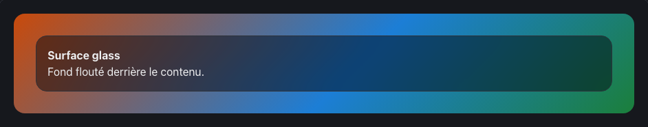

<!-- Généré par tools/docs/reference.mjs depuis packages/core/dist/manifest.json. Ne pas modifier à la main : npm run docs:reference. © 2026 Jonathan KABLAN — Propriétaire. -->

[← Référence](../README.md)

# Effet `glass`

Surface translucide floutée (glassmorphism).

| Clair | Sombre |
|---|---|
|  |  |

_Capture en mouvement réduit : état final affiché. Démonstration animée : `npm run catalog:serve` puis `effet-glass.html`._

## Usage web

```html
<div class="card fx-glass">
  <h3>Surface glass</h3>
</div>
```
```html
<link rel="stylesheet" href="noraivoire.css">
<script type="module" src="noraivoire.auto.js"></script>
```
### Flutter

```dart
NoraCard(
  glass: true,
  child: const Text('Surface verre'),
)
```

### React Native

```tsx
<NoraCard glass>
  <Text>Surface verre</Text>
</NoraCard>
```

## Options

Dans `data-fx-glass="clé:valeur;…"` ; une valeur hors bornes est ramenée dans l'intervalle.

| Option | Type | Défaut | Bornes |
|---|---|---|---|
| `blur` | number | `16` | 0 → 40 |
| `opacity` | number | `0.6` | 0 → 1 |

**Mouvement réduit** : sans objet (effet statique).

## Cibles

| Cible | Mise en œuvre |
|---|---|
| web | backdrop-filter avec repli opaque via @supports |
| react-native | fond semi-transparent (flou natif via adaptateur optionnel) |
| flutter | BackdropFilter + ImageFilter.blur |
