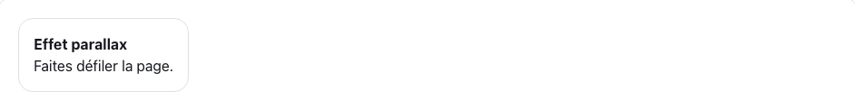
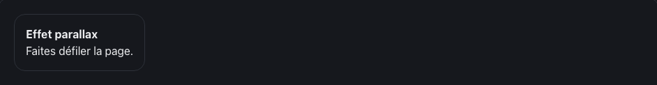

<!-- Généré par tools/docs/reference.mjs depuis packages/core/dist/manifest.json. Ne pas modifier à la main : npm run docs:reference. © 2026 Jonathan KABLAN — Propriétaire. -->

[← Référence](../README.md)

# Effet `parallax`

Décale verticalement l'élément selon sa position dans la fenêtre (effet de profondeur).

| Clair | Sombre |
|---|---|
|  |  |

_Capture en mouvement réduit : état final affiché. Démonstration animée : `npm run catalog:serve` puis `effet-parallax.html`._

## Usage web

```html
<div class="card" data-fx="parallax" data-fx-parallax="speed:20;reverse:false">
  <h3>Effet parallax</h3>
</div>
```
```html
<link rel="stylesheet" href="noraivoire.css">
<link rel="stylesheet" href="fx/fx-scroll.css">
<script type="module">
  import * as moteur from './noraivoire.engine.js';
  import { install } from './fx/fx-scroll.js';
  install(moteur); // paquet optionnel @noraivoire/fx-scroll
  moteur.start();
</script>
```
### Flutter

```dart
NoraParallax(
  speed: 20,
  child: Image.asset('assets/fond.jpg'),
)
```

### React Native

```tsx
<NoraParallax scrollY={scrollY} speed={20}>
  <Image source={require('./fond.jpg')} />
</NoraParallax>
```

## Options

Dans `data-fx-parallax="clé:valeur;…"` ; une valeur hors bornes est ramenée dans l'intervalle.

| Option | Type | Défaut | Bornes |
|---|---|---|---|
| `speed` | number | `20` | 0 → 100 |
| `reverse` | boolean | `false` | true / false |

**Mouvement réduit** : désactivé : état final affiché, rien n'est masqué.

## Cibles

| Cible | Mise en œuvre |
|---|---|
| web | animation-timeline: view() avec repli JS (défilement passif + rAF) |
| react-native | NoraParallax : Animated.Value du ScrollView + interpolate |
| flutter | NoraParallax : écoute de la ScrollPosition + Transform.translate |

Paquet optionnel **@noraivoire/fx-scroll** : aucun effet de bord à l'import, budget 2 Kio gzip.
