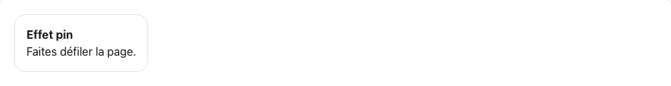
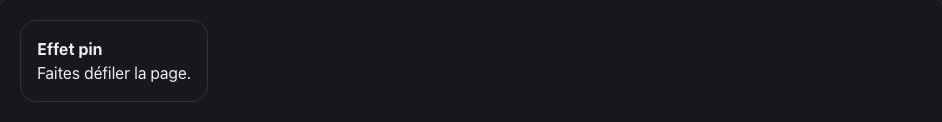

<!-- Généré par tools/docs/reference.mjs depuis packages/core/dist/manifest.json. Ne pas modifier à la main : npm run docs:reference. © 2026 Jonathan KABLAN — Propriétaire. -->

[← Référence](../README.md)

# Effet `pin`

Épingle l'élément (position: sticky) pendant le défilement de son parent et expose la progression dans --fx-pin-progress.

| Clair | Sombre |
|---|---|
|  |  |

_Capture en mouvement réduit : état final affiché. Démonstration animée : `npm run catalog:serve` puis `effet-pin.html`._

## Usage web

```html
<div class="card" data-fx="pin" data-fx-pin="top:0">
  <h3>Effet pin</h3>
</div>
```
```html
<link rel="stylesheet" href="noraivoire.css">
<link rel="stylesheet" href="fx/fx-scroll.css">
<script type="module">
  import * as moteur from './noraivoire.engine.js';
  import { install } from './fx/fx-scroll.js';
  install(moteur); // paquet optionnel @jonathankablan/noraivoire-fx-scroll
  moteur.start();
</script>
```
## Options

Dans `data-fx-pin="clé:valeur;…"` ; une valeur hors bornes est ramenée dans l'intervalle.

| Option | Type | Défaut | Bornes |
|---|---|---|---|
| `top` | number | `0` | 0 → 400 |

**Mouvement réduit** : conservé : aucun mouvement induit.

## Cibles

| Cible | Mise en œuvre |
|---|---|
| web | position: sticky (sans JS) + data-fx-pinned et --fx-pin-progress (JS) |
| react-native | non généré : ScrollView stickyHeaderIndices est l'équivalent natif |
| flutter | non généré : SliverPersistentHeader(pinned: true) est l'équivalent natif |

Paquet optionnel **@jonathankablan/noraivoire-fx-scroll** : aucun effet de bord à l'import, budget 2 Kio gzip.
