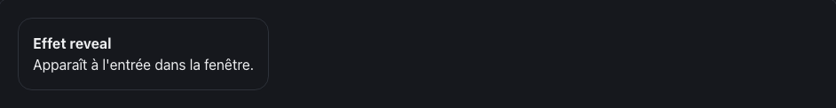

<!-- Généré par tools/docs/reference.mjs depuis packages/core/dist/manifest.json. Ne pas modifier à la main : npm run docs:reference. © 2026 Jonathan KABLAN — Propriétaire. -->

[← Référence](../README.md)

# Effet `reveal`

Fait apparaître l'élément (fondu + translation) quand il entre dans la zone visible.

| Clair | Sombre |
|---|---|
|  |  |

_Capture en mouvement réduit : état final affiché. Démonstration animée : `npm run catalog:serve` puis `effet-reveal.html`._

## Usage web

```html
<div class="card" data-fx="reveal" data-fx-reveal="distance:24;duration:400">
  <h3>Effet reveal</h3>
</div>
```
```html
<link rel="stylesheet" href="noraivoire.css">
<script type="module" src="noraivoire.auto.js"></script>
```
### Flutter

```dart
NoraReveal(
  distance: 24,
  child: NoraCard(child: const Text('Effet reveal')),
)
```

### React Native

```tsx
<NoraReveal distance={24}>
  <NoraCard><Text>Effet reveal</Text></NoraCard>
</NoraReveal>
```

## Options

Dans `data-fx-reveal="clé:valeur;…"` ; une valeur hors bornes est ramenée dans l'intervalle.

| Option | Type | Défaut | Bornes |
|---|---|---|---|
| `distance` | number | `24` | 0 → 120 |
| `duration` | number | `400` | 0 → 2000 |

**Mouvement réduit** : désactivé : état final affiché, rien n'est masqué.

## Cibles

| Cible | Mise en œuvre |
|---|---|
| web | animation-timeline: view() avec repli IntersectionObserver |
| react-native | onLayout + Animated |
| flutter | AnimatedOpacity + AnimatedSlide |
