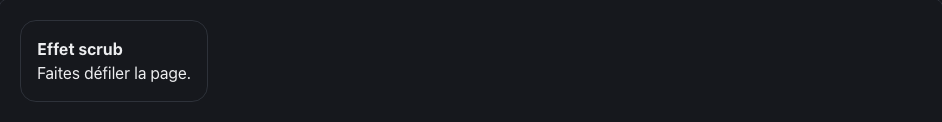

<!-- Généré par tools/docs/reference.mjs depuis packages/core/dist/manifest.json. Ne pas modifier à la main : npm run docs:reference. © 2026 Jonathan KABLAN — Propriétaire. -->

[← Référence](../README.md)

# Effet `scrub`

Expose la progression de l'élément dans la fenêtre (0 → 1) dans --fx-progress, pour piloter une animation CSS au défilement.

| Clair | Sombre |
|---|---|
|  |  |

_Capture en mouvement réduit : état final affiché. Démonstration animée : `npm run catalog:serve` puis `effet-scrub.html`._

## Usage web

```html
<div class="card" data-fx="scrub" data-fx-scrub="start:0;end:100">
  <h3>Effet scrub</h3>
</div>
```
```html
<link rel="stylesheet" href="noraivoire.css">
<link rel="stylesheet" href="fx/fx-scroll.css">
<script type="module">
  import * as moteur from './noraivoire.engine.js';
  import { install } from './fx/fx-scroll.js';
  install(moteur); // paquet optionnel @jonathankablan/noraivoire-fx-scroll
  moteur.start();
</script>
```
## Options

Dans `data-fx-scrub="clé:valeur;…"` ; une valeur hors bornes est ramenée dans l'intervalle.

| Option | Type | Défaut | Bornes |
|---|---|---|---|
| `start` | number | `0` | 0 → 100 |
| `end` | number | `100` | 0 → 100 |

**Mouvement réduit** : désactivé : état final affiché, rien n'est masqué.

## Cibles

| Cible | Mise en œuvre |
|---|---|
| web | défilement passif + requestAnimationFrame ; mouvement réduit → --fx-progress: 1 |
| react-native | web uniquement : Animated.Value du ScrollView + interpolate fait la même chose sans abstraction |
| flutter | web uniquement : ScrollController + AnimatedBuilder fait la même chose sans abstraction |

Paquet optionnel **@jonathankablan/noraivoire-fx-scroll** : aucun effet de bord à l'import, budget 2 Kio gzip.
