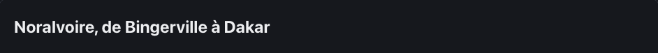

<!-- Généré par tools/docs/reference.mjs depuis packages/core/dist/manifest.json. Ne pas modifier à la main : npm run docs:reference. © 2026 Jonathan KABLAN — Propriétaire. -->

[← Référence](../README.md)

# Effet `split`

Découpe un texte en lettres ou en mots animés en cascade à l'apparition ; le texte complet reste lu une seule fois par les lecteurs d'écran.

| Clair | Sombre |
|---|---|
|  |  |

_Capture en mouvement réduit : état final affiché. Démonstration animée : `npm run catalog:serve` puis `effet-split.html`._

## Usage web

```html
<div class="card" data-fx="split" data-fx-split="words:false;stagger:30">
  <h3>Effet split</h3>
</div>
```
```html
<link rel="stylesheet" href="noraivoire.css">
<link rel="stylesheet" href="fx/fx-text.css">
<script type="module">
  import * as moteur from './noraivoire.engine.js';
  import { install } from './fx/fx-text.js';
  install(moteur); // paquet optionnel @jonathankablan/noraivoire-fx-text
  moteur.start();
</script>
```
## Options

Dans `data-fx-split="clé:valeur;…"` ; une valeur hors bornes est ramenée dans l'intervalle.

| Option | Type | Défaut | Bornes |
|---|---|---|---|
| `words` | boolean | `false` | true / false |
| `stagger` | number | `30` | 0 → 200 |

**Mouvement réduit** : désactivé : état final affiché, rien n'est masqué.

## Cibles

| Cible | Mise en œuvre |
|---|---|
| web | éléments span créés par createElement/textContent, DOM restauré au démontage |
| react-native | web uniquement : un Text par caractère casse la césure et l'accessibilité natives |
| flutter | web uniquement : un widget par caractère casse la césure et la sémantique natives |

Paquet optionnel **@jonathankablan/noraivoire-fx-text** : aucun effet de bord à l'import, budget 2 Kio gzip.
