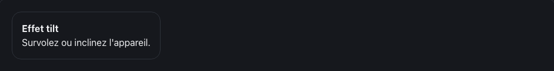

<!-- Généré par tools/docs/reference.mjs depuis packages/core/dist/manifest.json. Ne pas modifier à la main : npm run docs:reference. © 2026 Jonathan KABLAN — Propriétaire. -->

[← Référence](../README.md)

# Effet `tilt`

Incline l'élément selon l'orientation de l'utilisateur : souris sur desktop, gyroscope sur mobile.

| Clair | Sombre |
|---|---|
|  |  |

_Capture en mouvement réduit : état final affiché. Démonstration animée : `npm run catalog:serve` puis `effet-tilt.html`._

## Usage web

```html
<div class="card" data-fx="tilt" data-fx-tilt="max:10;glare:false">
  <h3>Effet tilt</h3>
</div>
```
```html
<link rel="stylesheet" href="noraivoire.css">
<script type="module" src="noraivoire.auto.js"></script>
```
### Flutter

```dart
NoraTilt(
  max: 10,
  child: NoraCard(child: const Text('Effet tilt')),
)
```

### React Native

```tsx
<NoraTilt max={10}>
  <NoraCard><Text>Effet tilt</Text></NoraCard>
</NoraTilt>
```

## Options

Dans `data-fx-tilt="clé:valeur;…"` ; une valeur hors bornes est ramenée dans l'intervalle.

| Option | Type | Défaut | Bornes |
|---|---|---|---|
| `max` | number | `10` | 0 → 30 |
| `glare` | boolean | `false` | true / false |

**Mouvement réduit** : désactivé : état final affiché, rien n'est masqué.

## Cibles

| Cible | Mise en œuvre |
|---|---|
| web | pointer \| deviceorientation |
| react-native | touch (gyroscope via adaptateur optionnel) |
| flutter | pointer (gyroscope via adaptateur optionnel) |
