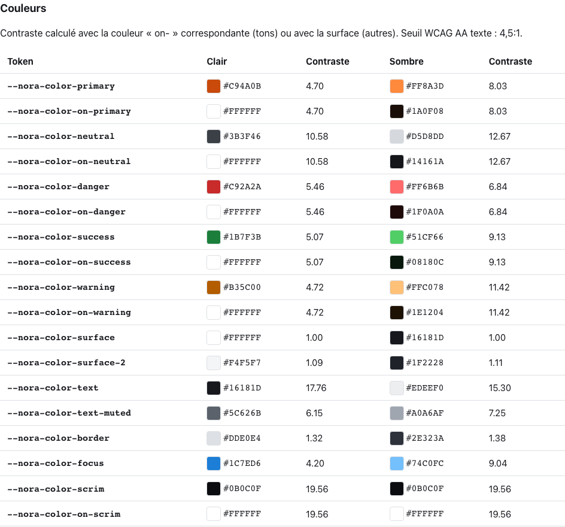
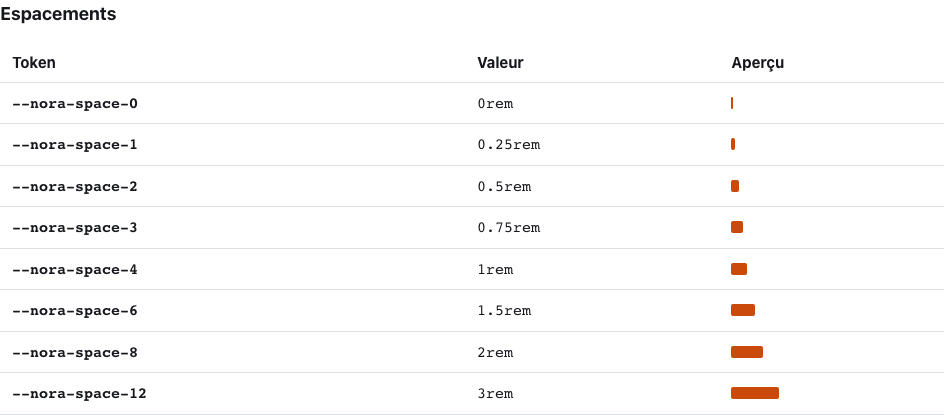
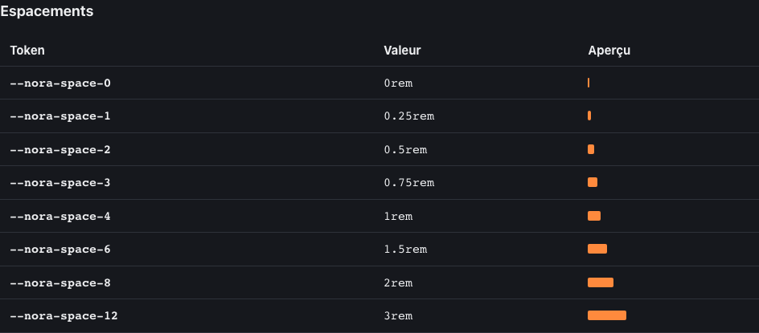
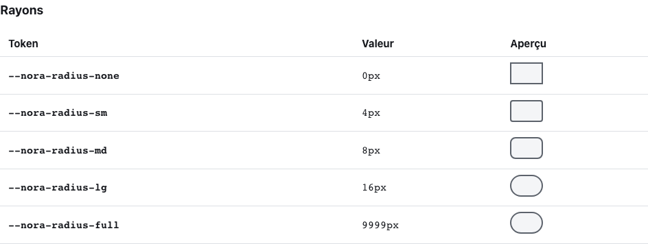
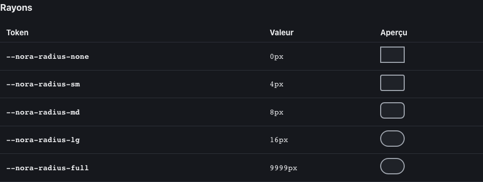
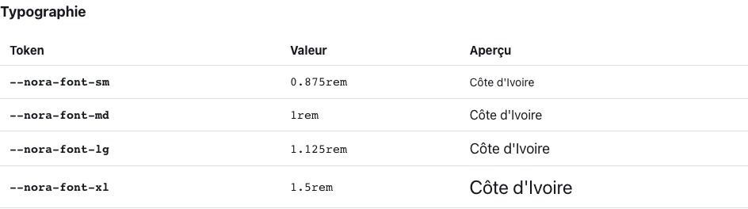
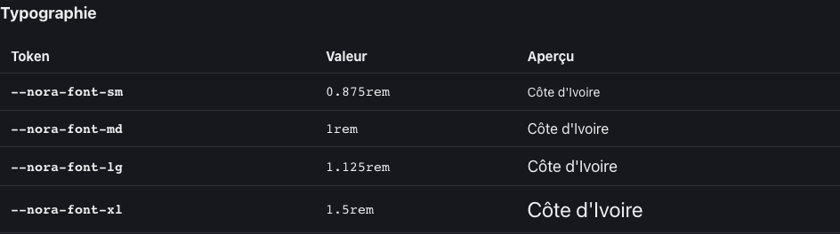

<!-- Généré par tools/docs/reference.mjs depuis packages/core/dist/manifest.json. Ne pas modifier à la main : npm run docs:reference. © 2026 Jonathan KABLAN — Propriétaire. -->

[← Référence](./README.md)

# Fondations

Grammaire, thèmes et tokens globaux (38 variables `--nora-*`), valeurs lues dans `noraivoire.css`.

## Grammaire

| Notion | Syntaxe |
|---|---|
| component | `.{composant}` |
| tone | `data-tone="{valeur}"` |
| size | `data-size="{valeur}"` |
| utility | `{propriété}-{échelle}` |
| surface | `fx-{nom}` |
| effect | `data-fx="{nom} {nom}" + data-fx-{nom}="clé:valeur;clé:valeur"` |
| token | `--nora-{groupe}-{clé} \| --{composant}-{clé}` |

## Thème

`data-theme="light|dark"` sur `<html>` (défaut : système, via `prefers-color-scheme`).

```html
<html lang="fr" data-theme="dark">
```

## Couleurs

| Clair | Sombre |
|---|---|
|  |  |

Contraste calculé avec la couleur `on-` correspondante (tons) ou avec la surface (autres). Seuil WCAG AA texte : 4,5:1.

| Token | Clair | Contraste | Sombre | Contraste |
|---|---|---|---|---|
| `--nora-color-primary` | `#C94A0B` | 4.70:1 | `#FF8A3D` | 8.03:1 |
| `--nora-color-on-primary` | `#FFFFFF` | 4.70:1 | `#1A0F08` | 8.03:1 |
| `--nora-color-neutral` | `#3B3F46` | 10.58:1 | `#D5D8DD` | 12.67:1 |
| `--nora-color-on-neutral` | `#FFFFFF` | 10.58:1 | `#14161A` | 12.67:1 |
| `--nora-color-danger` | `#C92A2A` | 5.46:1 | `#FF6B6B` | 6.84:1 |
| `--nora-color-on-danger` | `#FFFFFF` | 5.46:1 | `#1F0A0A` | 6.84:1 |
| `--nora-color-success` | `#1B7F3B` | 5.07:1 | `#51CF66` | 9.13:1 |
| `--nora-color-on-success` | `#FFFFFF` | 5.07:1 | `#08180C` | 9.13:1 |
| `--nora-color-warning` | `#B35C00` | 4.72:1 | `#FFC078` | 11.42:1 |
| `--nora-color-on-warning` | `#FFFFFF` | 4.72:1 | `#1E1204` | 11.42:1 |
| `--nora-color-surface` | `#FFFFFF` | 1.00:1 | `#16181D` | 1.00:1 |
| `--nora-color-surface-2` | `#F4F5F7` | 1.09:1 | `#1F2228` | 1.11:1 |
| `--nora-color-text` | `#16181D` | 17.76:1 | `#EDEEF0` | 15.30:1 |
| `--nora-color-text-muted` | `#5C626B` | 6.15:1 | `#A0A6AF` | 7.25:1 |
| `--nora-color-border` | `#DDE0E4` | 1.32:1 | `#2E323A` | 1.38:1 |
| `--nora-color-focus` | `#1C7ED6` | 4.20:1 | `#74C0FC` | 9.04:1 |
| `--nora-color-scrim` | `#0B0C0F` | 19.56:1 | `#0B0C0F` | 19.56:1 |
| `--nora-color-on-scrim` | `#FFFFFF` | 19.56:1 | `#FFFFFF` | 19.56:1 |

## Espacements

| Clair | Sombre |
|---|---|
|  |  |

| Token | Valeur |
|---|---|
| `--nora-space-0` | `0rem` |
| `--nora-space-1` | `0.25rem` |
| `--nora-space-2` | `0.5rem` |
| `--nora-space-3` | `0.75rem` |
| `--nora-space-4` | `1rem` |
| `--nora-space-6` | `1.5rem` |
| `--nora-space-8` | `2rem` |
| `--nora-space-12` | `3rem` |

## Rayons

| Clair | Sombre |
|---|---|
|  |  |

| Token | Valeur |
|---|---|
| `--nora-radius-none` | `0px` |
| `--nora-radius-sm` | `4px` |
| `--nora-radius-md` | `8px` |
| `--nora-radius-lg` | `16px` |
| `--nora-radius-full` | `9999px` |

## Typographie

| Clair | Sombre |
|---|---|
|  |  |

| Token | Valeur |
|---|---|
| `--nora-font-sm` | `0.875rem` |
| `--nora-font-md` | `1rem` |
| `--nora-font-lg` | `1.125rem` |
| `--nora-font-xl` | `1.5rem` |

## Durées

| Token | Valeur |
|---|---|
| `--nora-duration-fast` | `150ms` |
| `--nora-duration-base` | `250ms` |
| `--nora-duration-slow` | `400ms` |

## Surcharger un token

```css
:root {
  --nora-color-primary: #0B7285;
  --nora-radius-md: 4px;
}
:root[data-theme="dark"] {
  --nora-color-primary: #66D9E8;
}
```

Déclarez-les dans votre propre couche (`@layer app`) ou après `noraivoire.css` : aucune spécificité à combattre (`:where()`, pas de `!important`).
