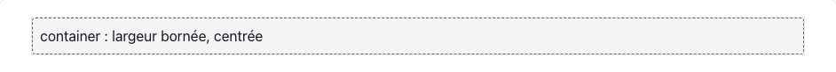
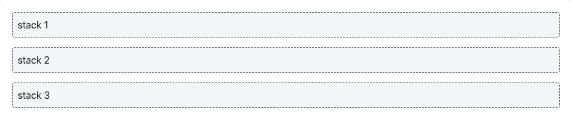
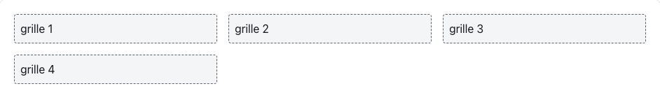
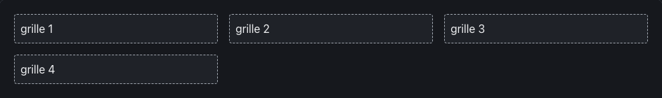
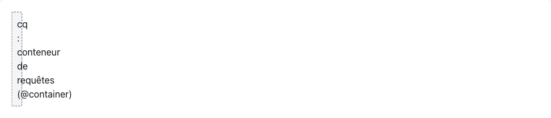
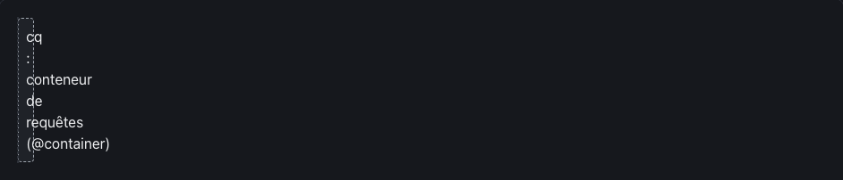

<!-- Généré par tools/docs/reference.mjs depuis packages/core/dist/manifest.json. Ne pas modifier à la main : npm run docs:reference. © 2026 Jonathan KABLAN — Propriétaire. -->

[← Référence](./README.md)

# Mise en page

5 primitives de mise en page, sans media query : elles s'adaptent à la place disponible.

## `container`

| Clair | Sombre |
|---|---|
|  |  |

```html
<div class="container">Largeur bornée, centrée</div>
```

## `stack`

| Clair | Sombre |
|---|---|
|  |  |

```html
<div class="stack">
  <div>1</div>
  <div>2</div>
</div>
```

## `cluster`

| Clair | Sombre |
|---|---|
|  |  |

```html
<div class="cluster">
  <span class="badge">a</span>
  <span class="badge">b</span>
</div>
```

## `grid-auto`

| Clair | Sombre |
|---|---|
|  |  |

```html
<ul class="grid-auto">
  <li class="card">…</li>
  <li class="card">…</li>
</ul>
```

## `cq`

| Clair | Sombre |
|---|---|
|  |  |

```html
<div class="cq">
  <!-- les enfants peuvent utiliser @container -->
</div>
```
