<!-- Généré par tools/docs/reference.mjs depuis packages/core/dist/manifest.json. Ne pas modifier à la main : npm run docs:reference. © 2026 Jonathan KABLAN — Propriétaire. -->

[← Référence](./README.md)

# Utilitaires

74 classes utilitaires, grammaire `{propriété}-{échelle}`. Elles l'emportent sur les composants (couche `nora.utilities`).

## Marge intérieure

`p-0` `p-1` `p-2` `p-3` `p-4` `p-6` `p-8` `p-12`

| Clair | Sombre |
|---|---|
| 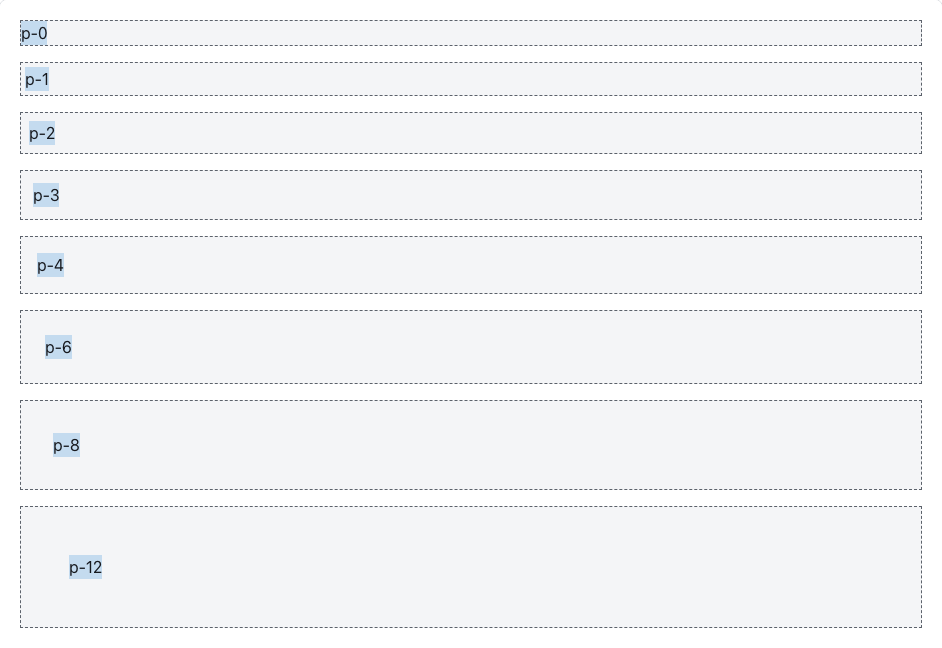 |  |

```html
<div class="card p-0">…</div>
```
## Marge intérieure horizontale

`px-0` `px-1` `px-2` `px-3` `px-4` `px-6` `px-8` `px-12`

| Clair | Sombre |
|---|---|
| 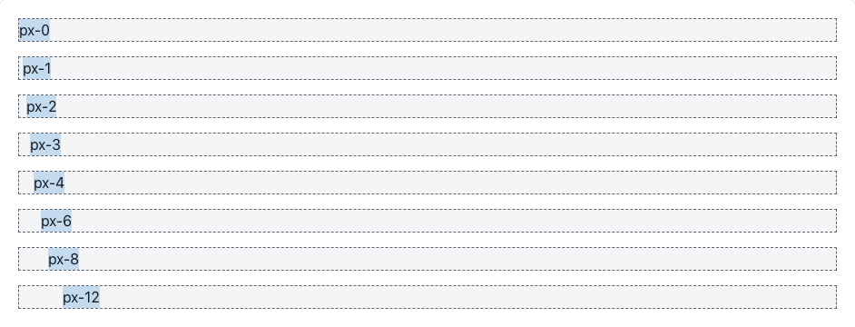 | 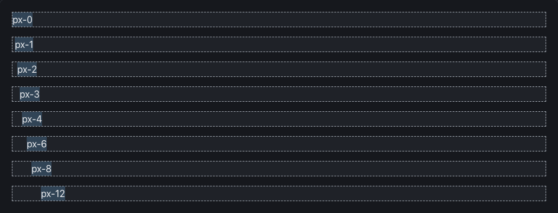 |

```html
<div class="card px-0">…</div>
```
## Marge intérieure verticale

`py-0` `py-1` `py-2` `py-3` `py-4` `py-6` `py-8` `py-12`

| Clair | Sombre |
|---|---|
| 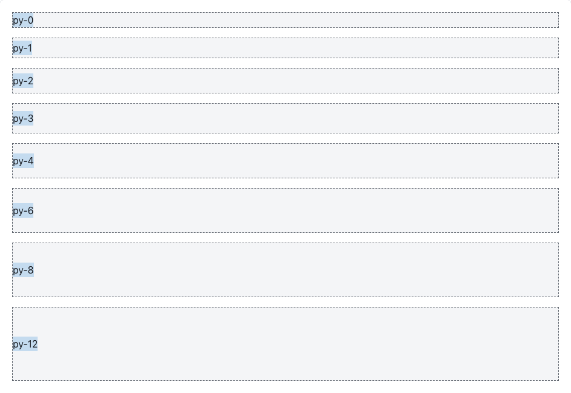 |  |

```html
<div class="card py-0">…</div>
```
## Marge extérieure

`m-0` `m-1` `m-2` `m-3` `m-4` `m-6` `m-8` `m-12`

| Clair | Sombre |
|---|---|
| 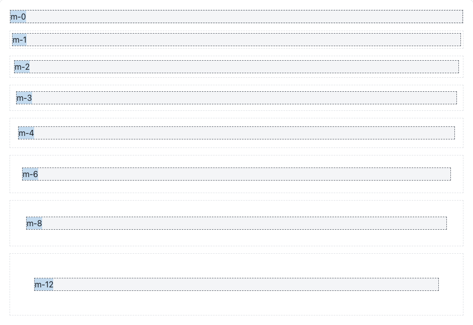 |  |

```html
<div class="card m-0">…</div>
```
## Marge extérieure horizontale

`mx-0` `mx-1` `mx-2` `mx-3` `mx-4` `mx-6` `mx-8` `mx-12` `mx-auto`

| Clair | Sombre |
|---|---|
| 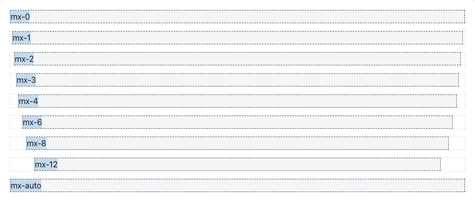 | 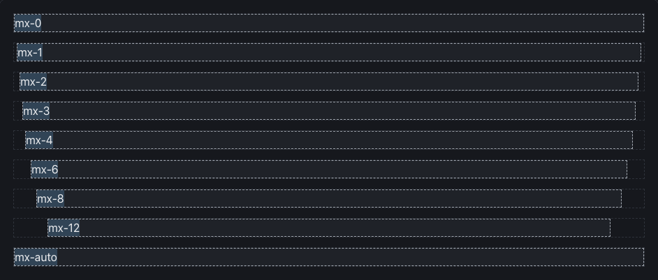 |

```html
<div class="card mx-0">…</div>
```
## Marge extérieure verticale

`my-0` `my-1` `my-2` `my-3` `my-4` `my-6` `my-8` `my-12`

| Clair | Sombre |
|---|---|
| 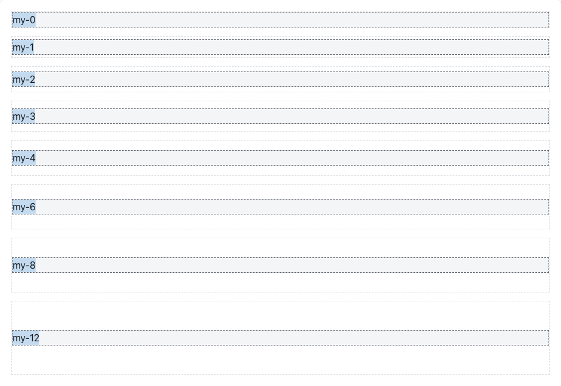 |  |

```html
<div class="card my-0">…</div>
```
## Espacement (flex / grille)

`gap-0` `gap-1` `gap-2` `gap-3` `gap-4` `gap-6` `gap-8` `gap-12`

| Clair | Sombre |
|---|---|
| 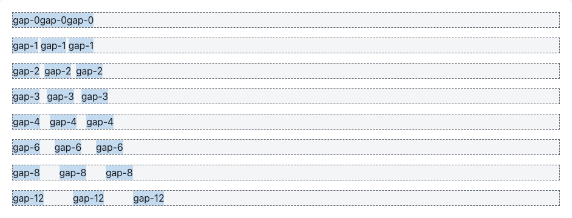 | 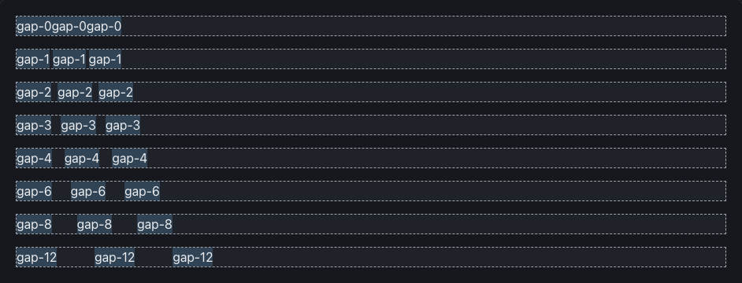 |

```html
<div class="card gap-0">…</div>
```
## Rayons

`rounded-none` `rounded-sm` `rounded-md` `rounded-lg` `rounded-full`

| Clair | Sombre |
|---|---|
| 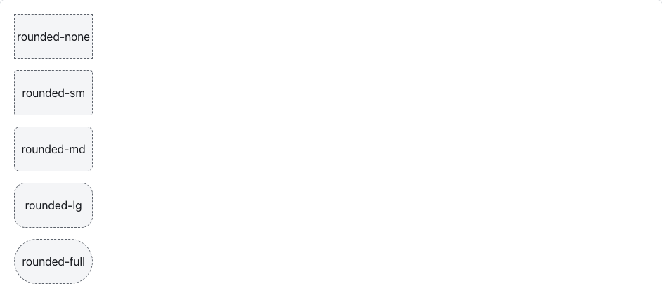 |  |

```html
<div class="card rounded-none">…</div>
```
## Texte

`text-sm` `text-md` `text-lg` `text-xl` `text-muted` `text-center`

| Clair | Sombre |
|---|---|
| 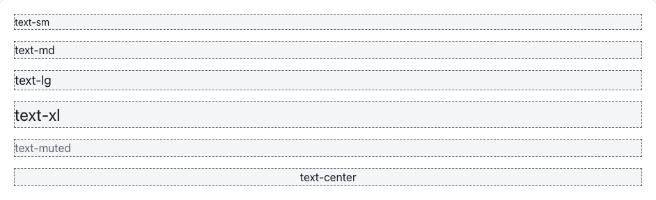 | 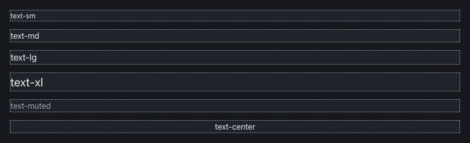 |

```html
<div class="card text-sm">…</div>
```
## Graisse

`font-bold`

| Clair | Sombre |
|---|---|
| 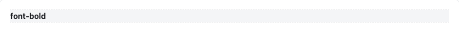 |  |

```html
<div class="card font-bold">…</div>
```
## Ombres

`shadow-sm` `shadow-lg`

| Clair | Sombre |
|---|---|
| 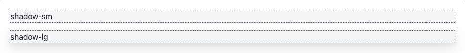 |  |

```html
<div class="card shadow-sm">…</div>
```
## Autres

`w-full` `hidden` `sr-only`

| Clair | Sombre |
|---|---|
| 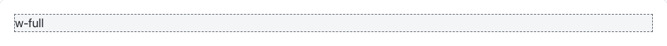 |  |

```html
<div class="card w-full">…</div>
```
